# astrocode: the Ledger

The interface spec for astrocode, phase 3 of the redesign. It specifies direction A from [directions/](directions/README.md), which you picked, and answers the problems the [audit](audit/README.md) found. Nothing here changes production code. [Migration](#migration) lists the PRs that will, in order.

| Phase | Status | Where |
| :-- | :-- | :-- |
| 1. Audit | Done | [audit/](audit/README.md) |
| 2. Directions | Done: A, Ledger | [directions/](directions/README.md) |
| 3. Spec | For review | This file |

**The idea in one sentence.** astrocode is one column that reads as the record of what Claude did and changed. Each turn closes with a ledger of its changes, which is also where you review them. A cursor opens any line in place, and decisions open under the line that asks.

Every picture here is a mockup: a grid of cells printed as true-color ANSI by [mockups/](mockups/) and screenshotted in kitty. Each picture is therefore something Ink can draw. `docs/design/mockups/shoot.sh` redraws them all after `check.ts` confirms two things: each frame is its stated size, and every glyph is in DejaVu Sans Mono.

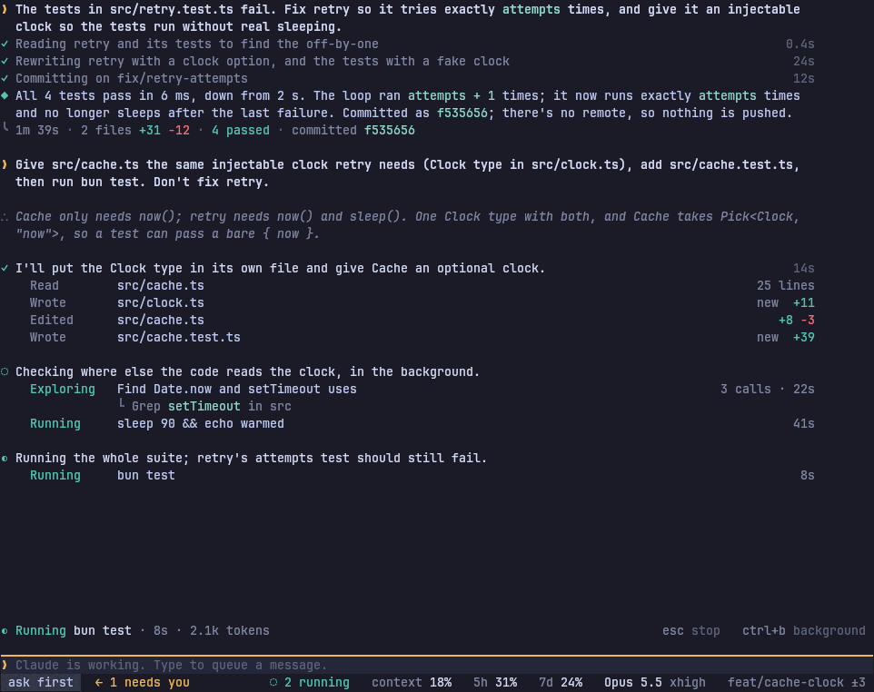

---

## Contents

1. [Principles](#principles)
2. [Visual language](#visual-language)
3. [Layout](#layout)
4. [Components](#components)
5. [Interaction model](#interaction-model)
6. [Storyboards](#storyboards)
7. [Migration](#migration)
8. [Open questions](#open-questions)

---

## Principles

Each principle comes with a test that a screen, or a design decision, passes or fails.

| # | Principle | Test |
| --: | :-- | :-- |
| 1 | **Drop-in first.** Whatever `claude` does, astrocode does with the same key, command and words. astrocode's own features use keys `claude` leaves free. | Press any key from Claude Code's default bindings, or from `~/.claude/keybindings.json`, in the same state in both. The result is the same, or the difference is listed under [Kept on purpose](#kept-on-purpose) with its reason. |
| 2 | **Every line is true when it's drawn.** A line says what happened (past tense), what is happening (present), or what is asked of you (a request). Every number comes from the call's result. | Freeze the screen at any moment. Each verb's tense matches its call's state, and each count can be found in what the call returned. |
| 3 | **One place per question.** The [now line](#the-now-line) says whether Claude is working or waiting, and on what. The ledger says what changed. The status bar says how much is left. | For each of those four questions, hide every region but the one named. The answer is still there, and no other region gives a different one. |
| 4 | **Say it once.** A state is put in words in one place. Elsewhere it may only be marked, by a color or a glyph. | Search the screen for a state's words ("waiting", "running", "failed"). They appear at most once. |
| 5 | **Gold means you.** Gold marks only three things: your messages, where your keys are, and whatever waits on you. | Every gold cell in any screenshot is one of the three. |
| 6 | **Open in place, one way.** Any line that stands for more opens with Enter or a click, under itself, at every width, and closes the same way. Nothing opens in a pane or panel beside the column. There is no second way to see the same thing. | For each kind of line (call, step, subagent, ledger file, thinking, picture, `… N more`), Enter and a click open the same content in the same place. |
| 7 | **Only live state moves.** The one thing that animates is the running mark: in the gutter of the running step, and on the now line. Text arrives as it streams; nothing else moves. | Record an idle screen, and one waiting on you, for two seconds. Every frame is identical. |

---

## Visual language

### Color by role

Colors are derived from your terminal's own background and text, as `tui/theme.ts` does today, so they read on any theme. The values shown are on Tokyo Night.

| Role | Means | Used for | Never for | Value |
| :-- | :-- | :-- | :-- | :-- |
| **text** | Content | Body text, targets | | terminal text `#c0caf5` |
| **bright** | What to read first | Your messages, step sentences, readings' values, the cursor row's text | Chrome | `#d6dcf8` |
| **haze** | Secondary | Verbs of finished calls, results, folded steps, thinking | Anything you must act on | `#8188a6` |
| **dust** | Structure | Gutter marks of quiet entries, line numbers, hint words, `·` separators | Content | `#5f6580` |
| **surface** | A panel | The box, decisions, opened entries, code blocks | Prose | `#24273a` |
| **raised** | The cursor's row | The row under the cursor, the chosen option, the open tab | Decoration | `#30344a` |
| **gold** | You | Your `❯`, the focus hairline, the cursor `›`, whatever waits on you, `← 1 needs you` | Modes, scroll position, branding | `#f0b85a` |
| **teal** | Claude at work, or work that went well | The running mark and verb, `✓`, `◆`, `+N`, passed tests | Your things | `#56c6b6` |
| **rose** | Failed or removed | `✕`, failed tests, `−N`, removed diff lines | Warnings | `#f2707e` |
| **ember** | Stopped, refused or slowed | `■`, `Not run`, `Retrying`, `auto` mode | Failure | `#f0975e` |
| **sky** | Elsewhere | Links, PR numbers, `plan` mode | | `#86a8f0` |
| **code** | Code in prose | Identifiers in Claude's words: color only, no fill, no padding | Paths in activity lines | `#93d9cd` |

- **Diffs** tint whole rows: added rows toward teal, removed toward rose, at 16% on the panel. The changed words inside a row are tinted at 34%.
- **The mode chip** sits on a raised fill, with its word in the mode's color: ask first in text, accept edits in teal, plan in sky, auto in ember, bypass permissions in rose.

### Glyphs

Every glyph is in DejaVu Sans Mono, which `check.ts` confirms; no Nerd Font is needed. Kitty draws box-drawing and block characters itself.

| Glyph | Where | Means |
| :-- | :-- | :-- |
| `❯` gold | Gutter, box | You: your message, the box |
| `∴` dust | Gutter | Claude's thinking |
| `◆` teal | Gutter | Claude's reply |
| `◐` teal, turning `◐◓◑◒` | Gutter, now line | Running now. The only thing that moves |
| `◇` gold | Gutter | Waits for you |
| `✓` teal | Gutter | Done |
| `✕` rose | Gutter | Failed: the step's last call failed |
| `■` ember | Gutter | Stopped |
| `◌` teal | Gutter, status bar | In the background |
| `○` dust | Gutter | A notice: something finished, resumed or compacted |
| `╰` dust | Gutter | The turn's ledger |
| `›` gold | Cursor row, chosen option | Where your keys point |
| `└` dust | Under a line | What's inside it: a subagent's latest call, or why it failed |
| `⋯ N lines` | Diffs, long output | Hidden lines, which Enter opens |
| `▁` gold | Above a region | That region has your keys |
| `·` dust | Inside a line | Separates readings |
| `+N` `−N` | Results | Lines added and removed |

### Spacing and density

- **Gutter.** Column 0 holds one mark per entry; text starts at column 2. There is no vertical rule.
- **Activity lines.** The verb starts at column 4 in a 12-column field, or 10 under 100 columns. The target follows, and the result ends at the measure's edge.
- **Measure.** Text never runs wider than 110 columns, whatever the width, so results sit within 110 columns of their targets.
- **Rows.**
  - One blank row before your message, before each step, and before the reply.
  - No blank row inside a step, between a reply and its ledger, or between folded steps.
- **Panels.** Panels are filled, never boxed with lines. Opened entries indent to column 4. A panel's top edge is a hairline: gold when the panel has your keys, the panel's own color otherwise.
- **Hints.** One hint line at a time, belonging to whatever has your keys.
- **Finished turns** fold to your message, Claude's step sentences, the reply and the ledger.

### Motion

| Moves | Why |
| :-- | :-- |
| `◐◓◑◒` at 4 frames a second, on the running step's mark and the now line, in step | Claude is doing something right now |
| Words appearing in a streaming reply | That's the content arriving |
| The ledger's numbers updating as calls land, without animation | They're facts changing |

Nothing else moves: no shimmer, no falling light, no mirror animation, no blinking cursor (kitty's cursor setting decides). When Claude waits on you, the mark stops and turns into `◇`.

---

## Layout

### Regions

Top to bottom:

| Region | Rows | Holds |
| :-- | :-- | :-- |
| **Transcript** | The rest | The conversation. It starts at the top while it fits. Once it doesn't, it follows the end while Claude works, unless you've scrolled away. While a decision is open, its end sits right above the decision. |
| **Pinned** | 0 rows, up to a third of the height | Your to-do list (Ctrl+T), queued messages, and mods' band. Under 30 rows it folds to one summary line, such as `3 of 5 to-dos · 1 queued`. |
| **Now line** | 1, only during a turn | What Claude is doing now, its time and tokens, and the keys that stop it. |
| **Box** | 2: a hairline and a row, growing with your text up to a third of the height | Where you type. A decision (permission, question, plan, MCP form) takes its place until you answer. |
| **Status bar** | 1 | The mode, who else needs you, then readings by rank. |

### Width

| | 80×24 | 120×40 | 200×50 |
| :-- | :-- | :-- | :-- |
| **Text and results** | To column 78. A result that doesn't fit goes on the next row | To column 112 | To column 112, the measure |
| **An opened entry** | In place | In place | In place, at the measure |
| **Diff in a decision** | Unified; long lines wrap | Unified | Side by side, once the panel is 160 or wider |
| **Status readings** | Running, context, 5h, 7d | Adds model and effort, then branch | All |
| **Hint line** | Keys that don't fit are left to `?` | All | All |

| 80×24 | 200×50 |
| :-- | :-- |
| 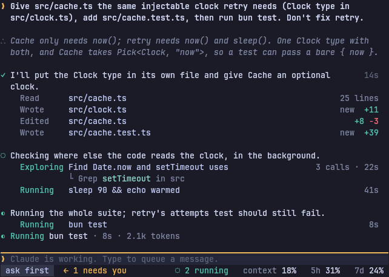 | 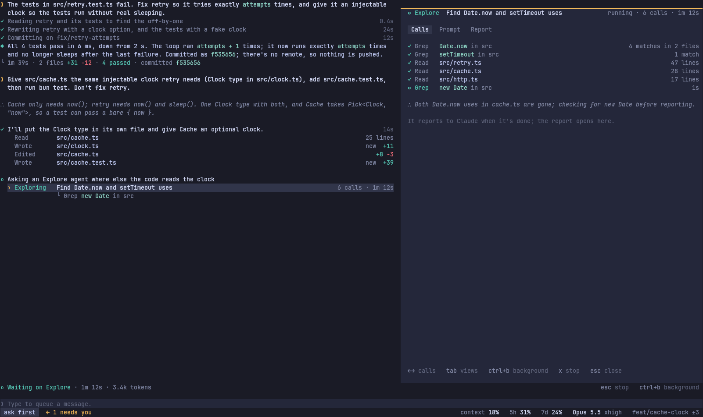 |

**Status readings by rank:** context, 7d, running, 5h, model and effort, branch and changed files. They drop from the end as the width shrinks ([states](shots/states.png) shows 120 and 80). The mode and `← N needs you` always stay.

### Height

- **Under 30 rows,** the pinned area folds to one line.
- **A decision** shows at most half the screen of diff, then `⋯ N lines · ctrl+o whole file`. The line that asks always stays visible above it.
- **An opened entry in place** shows its first 12 rows and last 8, with `⋯ N lines` between, which Enter opens.

### Scrollback and full screen: keep both, as one design

**Decision:** keep both layouts with the same look and the same keys. The only difference is where the transcript cursor lives:

- **Full screen** (`-f`, `/fullscreen`, remembered): the cursor works on the transcript itself, Ctrl+O moves your keys there, and the mouse works.
- **Scrollback**, the default as in `claude`: finished output goes to your terminal's scrollback. Ctrl+O opens the session in a full-screen viewer with the same cursor and keys. That's the model `claude` has: inline, plus Ctrl+O's transcript viewer.

**Why not one:**
- **Dropping scrollback** breaks drop-in. `claude`'s default is inline, and people rely on their terminal's own scrollback, search and copy.
- **Dropping full screen** loses the mouse and open-in-place on everything. You use full screen every day.
- **Both already exist** (`tui/screen.tsx` and `tui/window.ts`). The work is to make them draw the same entries the same way.

---

## Components

States, in the brief's terms:

| State | Means here |
| :-- | :-- |
| **Idle** | Nothing running |
| **Active** | Claude is working on it |
| **Waiting** | It waits on you |
| **Done** | Finished well |
| **Failed** | Finished badly |
| **Stopped** | You or Claude stopped it |

[states](shots/states.png) draws every one:

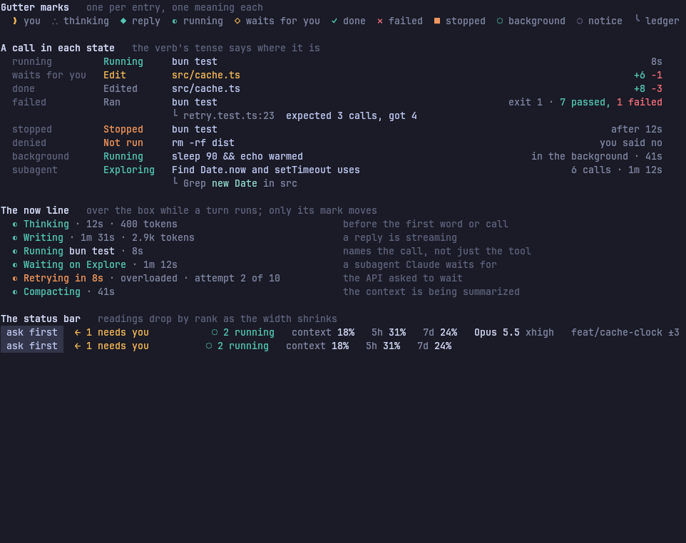

### Your message

- **Mark:** gold `❯`, then the text in bright bold, wrapped at the measure.
- **Content:** Pasted text over 12 lines folds to its first 6 and `⋯ N lines`. Images show as `[image 1]` chips, and in kitty as a thumbnail under the message. Keywords (`ultrathink`, `ultracode`) are colored as today.
- **States:**
  - **Queued:** shown in the pinned area as `queued: …  ↑ edits`, or `after this turn` for Ctrl+X Enter. It moves into the transcript once Claude takes it.

### Thinking

- **Mark:** dust `∴`, then the first sentence of Claude's thinking summary, in haze italic.
- **Opening:** Enter opens the whole thinking in place.
- **Content:** One summary per stretch of thinking, above the step or reply it led to. This replaces your `inline-thinking` mod in astrocode.

### Step

A step is the calls Claude makes after one sentence of its own.

| State | Mark | Heading | Lines |
| :-- | :-- | :-- | :-- |
| Active | `◐` teal, turning | Claude's sentence, in bright | Every call |
| Waiting | `◇` gold | Same | The waiting call in gold, then the decision under it |
| Done | `✓` teal | Same, with its time at the edge | Every call. Folds to the heading once the turn ends |
| Failed | `✕` rose | Same | Every call, with the failure under the failed one |
| Stopped | `■` ember | Same | Calls up to the stop |
| Background | `◌` teal | Same | Calls still running in the background |

- **Heading:** always Claude's own sentence. A step with no sentence of its own has no heading: its calls sit under the previous heading, or directly under your message. Names made from calls are gone.
- **Length:** at most 6 lines (the first 2 and the last 3) with `… N more` between, while running and after. Enter on `… N more` opens the rest.

### Activity line (one call)

A line reads: verb · target · result. Its tense follows its state:

| Tool | Active | Waiting | Done | Failed | Not run |
| :-- | :-- | :-- | :-- | :-- | :-- |
| Read | `Reading src/x.ts` | `Read src/x.ts` (gold) | `Read src/x.ts  41 lines` | `Read … ✕ not found` | `Not run  Read src/x.ts  you said no` |
| Edit, Write | `Editing src/x.ts` | `Edit src/x.ts  +6 −1` (gold) | `Edited src/x.ts  +8 −3` · `Wrote src/y.ts  new +11` | `Edit … ✕ old text not found` | `Not run …` |
| Bash | `Running bun test`, or Claude's description in the present tense | `Run bun test` (gold) | Claude's description in the past tense, or `Ran $ cmd`, with its result | `Ran bun test  exit 1 · 7 passed, 1 failed` | `Not run …` |
| Grep, Glob | `Searching Date.now in src` | `Search …` | `Searched Date.now in src  4 matches in 2 files` | | |
| Agent | `Exploring  <task>  6 calls · 1m 12s`, with `└ <its latest call>` | | `Explored <task>  4 matches in 2 files · 31s` | `✕ <why>` | |
| WebFetch, WebSearch | `Fetching example.com/x` | `Fetch …` | `Fetched …  200 · 14 KB` | `✕ 404` | |
| MCP and other tools | `Calling server · tool` | `Call …` | `Called server · tool  <first line of the result>` | `✕ <error>` | |
| `show` | `Drawing <label>` | | `Showed <label>`, with the picture under it | `✕ <why>` | |

Rules:
- **Results come from the result.**
  - Test counts appear only when the output is a test runner's summary (bun, jest, vitest, pytest, cargo, go).
  - A command with only a line count shows nothing but its exit code if it failed.
- **The failure line** (`└`, text color) is the first line of the error that says what went wrong: the assertion for a test (`expected 3 calls, got 4`), the message for an exception, stderr's last line for a command. It is never a source line.
- **Denied, and stopped while waiting,** read `Not run`, in ember. A call stopped mid-run reads `Stopped … after 12s`.
- **Duration** shows only for calls longer than 5 s. **Line counts** show only for reads.
- **No `›`, no diff-meter bar, no repeated verb.** A run of the same verb writes it once.

### Subagent

- **While it runs:** `Exploring <task>  N calls · time` in teal, with `└ <its latest call>` under it. The latest call turns gold when it waits for your OK, and its decision names the subagent.
- **Opened:** with Enter or a click, under its line. It has tabs: Calls (its own activity lines, streaming in live), Prompt (what Claude asked it) and Report (once it's done). `/tasks` stays for the full-screen view.
- **Moving it:** Ctrl+B sends it to the background. `x` stops it.
- **Nesting:** a subagent it starts nests under it, indented two more columns.

### Reply

- **Mark:** teal `◆`, then text in the text color, wrapped at the measure.
- **Code:** inline code in the code color, without a fill.
- **Blocks:** panels. Shell blocks show `▶ run  copy` only when the cursor or pointer is on them; `r` and `c` do the same with the cursor there.
- **Tables:** no grid. **Quotes:** on a dust hairline.
- **While streaming:** words arrive and nothing else moves.

### Turn ledger

The line that closes a turn, and the review surface.

`╰ 1m 40s · 3 files +58 −3 · 7 passed 1 failed · not committed`

- **Order:** time · files changed with totals · tests · commits, pushes and PRs (`committed f535656`, `pushed`, `PR #12`) · `not committed` in ember when files changed and nothing was committed. The turn's tokens show when the ledger is opened.
- **What counts as a change:** whatever changed in the working tree between the turn's start and its end, edits made through Bash included.
  - At each turn's edge, astrocode records the working tree as a git tree object, built with a temporary index so your own index and stash are untouched. The ledger is the diff between the two trees.
  - Outside git, the edit tools' own diffs count.
  - Files under `~/.claude` don't count, unless the project is there, as when you work on a skill.
- **Stopped:** `╰ stopped after 41s · …`. **Failed** (an API error): `╰ failed: <message> · …`.
- **Opened** (Enter, a click, or `/diff` for the latest turn), it lists:
  - each file, with `new`, `+N −N` or `deleted`;
  - then the commands it ran, with their results, and the commits;
  - and the turn's tokens.
  - Enter on a file opens its diff for that turn under it. `a` opens them all.
- **Scope:** `[` and `]` switch it between this turn, uncommitted, and the branch against its base, as `claude`'s `/diff` does.

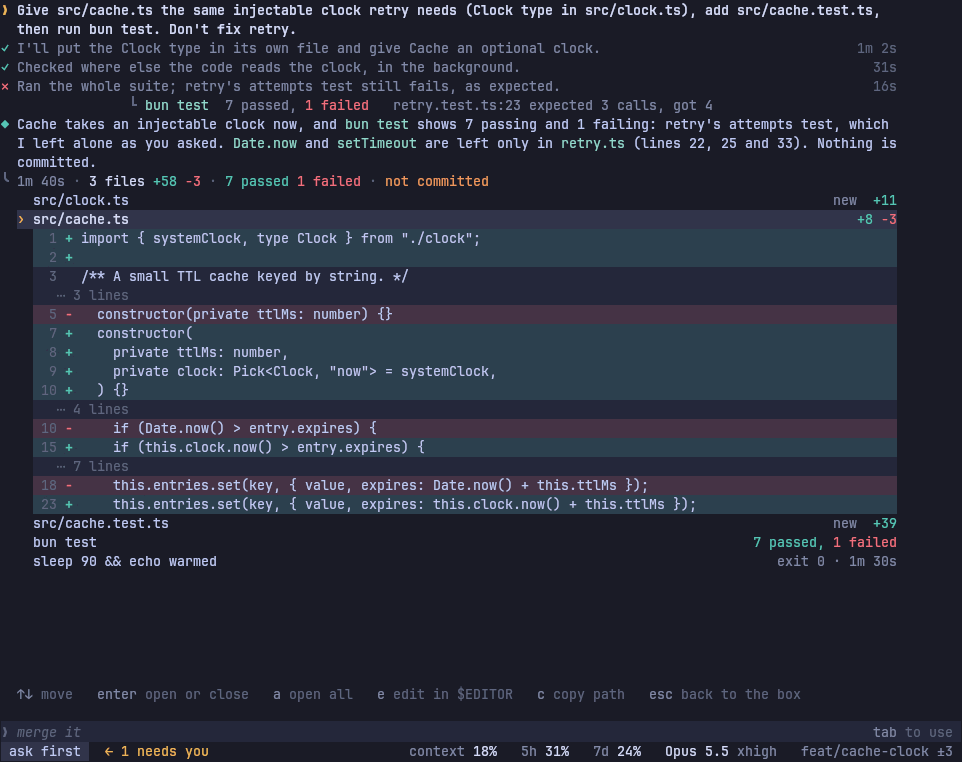

### Your shell commands (`!`)

A command you run with `!` gets a card in the transcript: `! <command>` with `running 15s` at the edge, and its last 6 lines of output on a panel under it.
- **Opening:** Enter, with the cursor on it, opens the whole output.
- **Stopping:** `x` stops it, as does `/tasks`.
- **When it ends:** the card folds to `! <command>  exit 0 · 40 lines`. Claude reads what it printed, as today.
- **No second copy:** `/tasks` lists it but opens the same card, not another copy of the output.

### Pinned area

Above the now line, with nothing in it unless something's there:
- **To-do list** (Ctrl+T, or while to-dos are left): a summary line `3 of 5 to-dos`, then one line each with `✓`, `◐` or `○`.
- **Queued messages:** `queued: <text>  ↑ edits`.
- **Mods' band.**

It takes at most a third of the height, and folds to its summary lines under 30 rows.

### Notices

A dust `○` line for:
- background work that ended (`Background command finished: sleep 90 && echo warmed · exit 0`);
- Claude picking up on its own (`Claude picked up: a Monitor event`);
- a resume (`Resumed "<title>"; earlier turns are folded above`);
- a compaction (`Compacted: 142k tokens to 18k`).

### The now line

One row over the box, only during a turn. It reads mark · what · time · tokens, with keys on the right: `esc stop`, plus `ctrl+b background` when something can move there.

| State | Reads |
| :-- | :-- |
| Thinking | `◐ Thinking · 12s · 400 tokens` |
| Writing | `◐ Writing · 1m 31s · 2.9k tokens` |
| A call | `◐ Running bun test · 8s`. It names the target, not just the tool |
| A subagent | `◐ Waiting on Explore · 1m 12s` |
| Retrying | `◐ Retrying in 8s · overloaded · attempt 2 of 10`, in ember |
| Compacting | `◐ Compacting · 41s` |
| Waiting on you | No now line: the decision panel says it |

### Box

| State | Looks like |
| :-- | :-- |
| Idle, with your keys | Gold hairline, `❯`, a placeholder (`Try "…"` on a new session) |
| Claude working | `Claude is working. Type to queue a message.` Enter queues the message between calls, Ctrl+X Enter after the turn, Ctrl+Enter now |
| A suggestion | Claude Code's next-prompt suggestion in dust italic, `tab to use` at the right edge. Tab or → takes it, as in `claude` |
| Without your keys | Dust hairline and `❯` |
| A decision open | Hidden; the decision takes its place |
| `!` first | Shell mode: `!` in gold, and Enter runs the command into a card |
| `/` or `@` first | The menu opens above the box (see below) |
| Stashed (Ctrl+S) | `1 put aside · ctrl+s` at the right edge |

**`/` and `@` menus** open above the box and use the free rows, up to half the screen. A row is name · description, with the chosen one raised. The hint reads `↑↓ choose · tab complete · enter run · esc close`. Enter on a `/word` in the middle of a message sends it as typed, as `claude` does.

### Status bar

- **Left:** the mode chip, and `← N needs you` in gold when another conversation waits on you.
- **Right:** readings by rank, `context 18%  5h 31%  7d 24%  Opus 5.5 xhigh  feat/cache-clock ±3`. The 5-hour and 7-day readings turn ember from 80% and rose from 95%, with the reset time.
- **Cut:** the plan name, the `shift+tab` hint (it's in `?`), and the cache timer, which appears only under 10 minutes or once cold, as `cache 6m`.
- **While on:** `◌ N running`, `↯ fast`, `thinking off` and `⇄ remote`.

### Decisions

A decision takes the box's place, with a gold hairline and your keys. The line that asks sits right above it. For the first half second it ignores Enter, Space and digits.

| Kind | Body | Options |
| :-- | :-- | :-- |
| Permission: Bash | `$ command` once, then Claude's description in haze | `claude`'s, word for word: Yes · Yes, and don't ask again for `<each command>` here · Yes, and switch to auto mode (where offered) · No, and tell Claude what to do instead |
| Permission: Edit, Write | The diff, with line numbers | `claude`'s: Yes · Yes, and accept edits for this session (shift+tab) · No |
| Permission: other | Tool, server and input, as `claude` shows them | `claude`'s |
| From a subagent | `Explore asks:` above the title | Same |
| Claude's question | The question as the title. Options with descriptions; the preview beside them at 100 columns and up, under them below that, and a picture in kitty | Digits pick, Space checks (multi), Other… types, `n` adds a note (as `claude`), Esc dismisses |
| Plan | The plan is drawn in the transcript as Claude's entry, right above. The panel holds the plan's file and the choices | `claude`'s plan choices |
| MCP form | The server's fields | Tab next field · Enter submit · Esc decline |

Tab on Yes or No opens a comment field for that answer, as in `claude`. Every decision's hint line is `↑↓ or 1–N choose · enter confirm · tab comment · ctrl+o whole file`.

| Permission, 120×40 | Permission, 80×24 | Question |
| :-- | :-- | :-- |
| 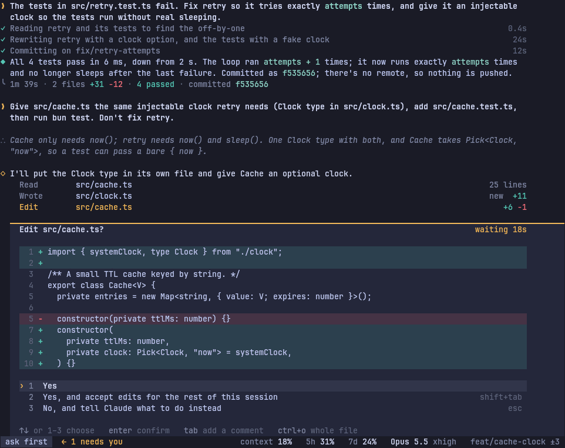 | 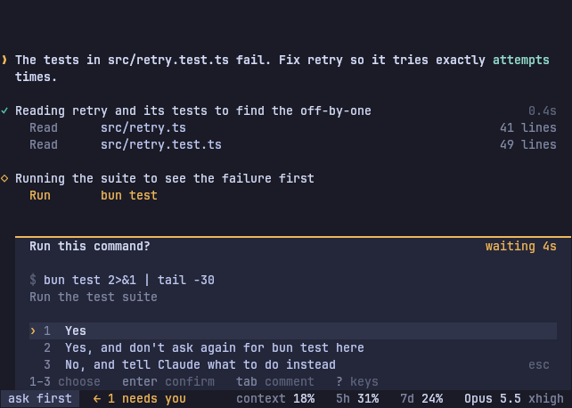 | 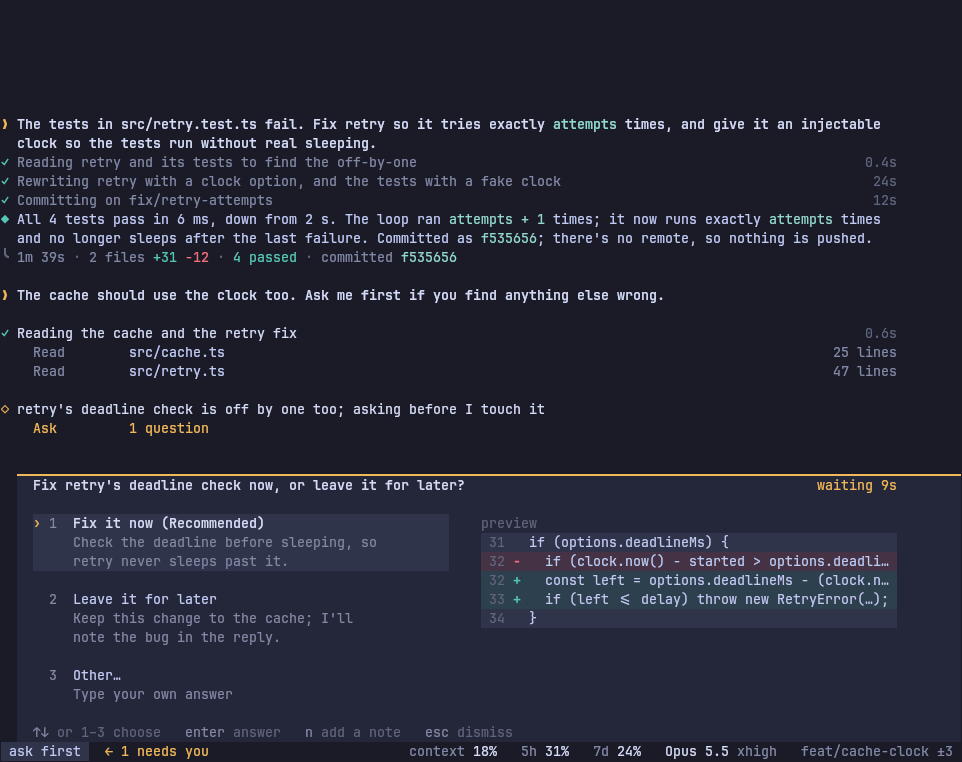 |

### Opened call (what the inspector was)

Enter or a click on a call opens it under its line, at every width.

- **Header:** what it did, its result chip (`✓ exit 0`, `✕ exit 1`), its time and `‹ 9 of 10 ›`.
- **Tabs** depend on the tool, as today: Output, Command, Sent to Claude, Input; Diff; Content; Calls, Prompt and Report for subagents.
- **Keys:** ← and → move to the call before or after; Tab moves between tabs; `c` copies the tab; `e` opens it in `$EDITOR`. Esc or Enter closes it.
- **Follow Claude** retires. Opening the running line shows the live call under it. While it's open, each new call opens under its own line as it starts, and the one before closes, until you move the cursor.

### Pictures and diagrams

- **In kitty:** drawn under the `show` call or the fence, with a caption line `<label> · enter enlarges · o opens · b browser`. Enter or a click grows it in line, to the measure and up to the transcript's height; again shrinks it back.
- **Without kitty:** the line reads `picture: <label> · o opens it`.
- **`/pictures`** stays, as the only full-screen view of a picture: ← and → move between pictures, `o` opens one, `b` opens it in the browser, `c` copies a diagram's source.

### Overlays

`/tasks`, `/config`, `/plugins`, `/resume`, the model picker, `/mcp`, `/permissions`, `/memory`, `/skills`, `/hooks`, `/sandbox` and rewind.

- **Where:** a panel above the box with a gold hairline. Its title row reads name · scope. Its body is a list with the chosen row raised. One hint line.
- **Same keys in every overlay:**
  - ↑↓ choose; type to filter; Enter acts.
  - Tab, or ← and →, switch lists, keeping the filter.
  - Space toggles in lists that toggle.
  - Esc closes. In `/config`, changes take effect as you make them, as in `claude`.
- **The wheel** over an overlay scrolls the overlay.
- **`/resume`:** each row shows the session's ledger summary and which app ran it.
- **`/help`:** shows the `?` sheet.

| `/resume` | `?` |
| :-- | :-- |
| 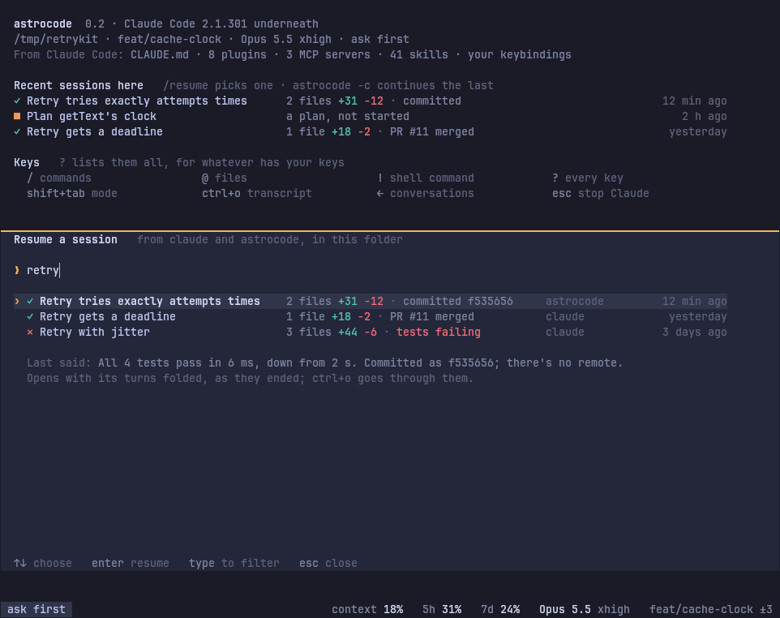 | 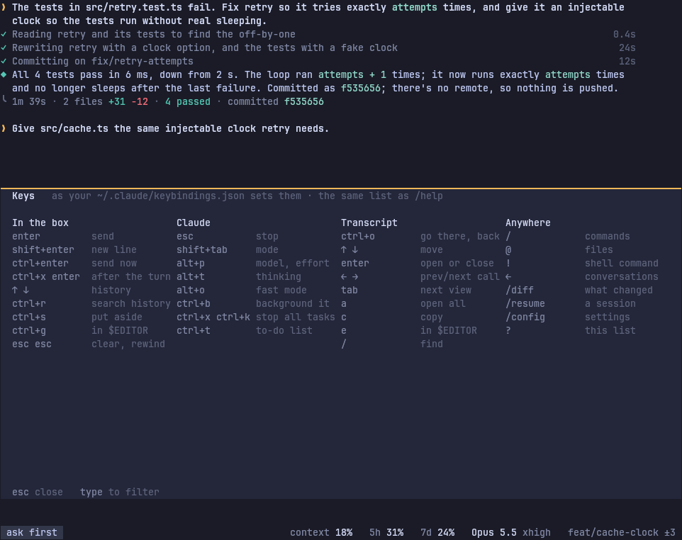 |

### Conversations (the agents view)

Same rows and keys as today and as `claude agents`, drawn with the Ledger's marks.

- **Header:** where a new conversation starts, its model and its mode, then the counts (`1 needs you · 2 working · 3 done · 1 failed`).
- **Rows:** grouped by project. Each reads mark · name · what it's doing or did, in ledger words, with Markdown stripped · PR · age. The one you came from says `(this one)`.
- **Status bar:** stays, so you can see the mode and plan.
- **Inside a conversation:** `← N needs you` in the status bar says when another one waits on you, and ← (or a click on it) opens the view.

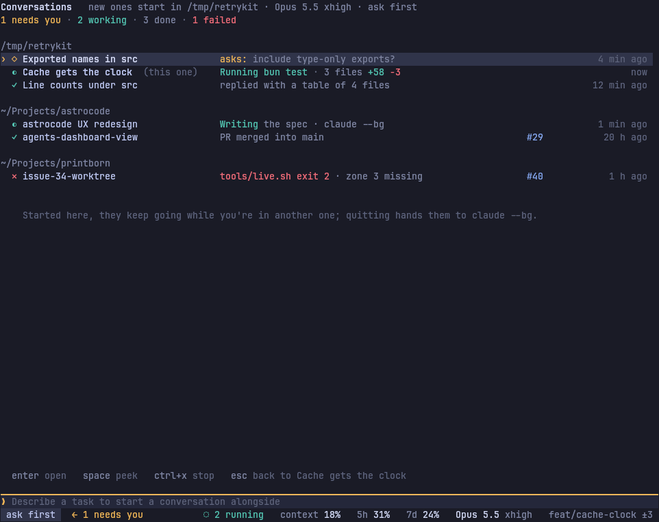

### Mods

- **Band:** mods' band (`AbovePrompt`) draws in the pinned area. Ctrl+X Tab gives it your keys, and Tab and Enter press its buttons, as in `claude`.
- **Cards:** mods' cards (`ToolResult`, `CommandOutput`) draw under their call's line. Their buttons work, by click and by Enter with the cursor on them.
- **Status lines and toasts** draw where they do today.

### Start screen

Nothing is drawn large. The screen shows:
- the name, version and engine;
- where you are, with branch, model, effort and mode;
- what astrocode loaded from Claude Code (CLAUDE.md, plugins, MCP servers, skills, keybindings);
- recent sessions in this folder, with their ledgers;
- eight keys.

The JWST mirror retires from the screen.

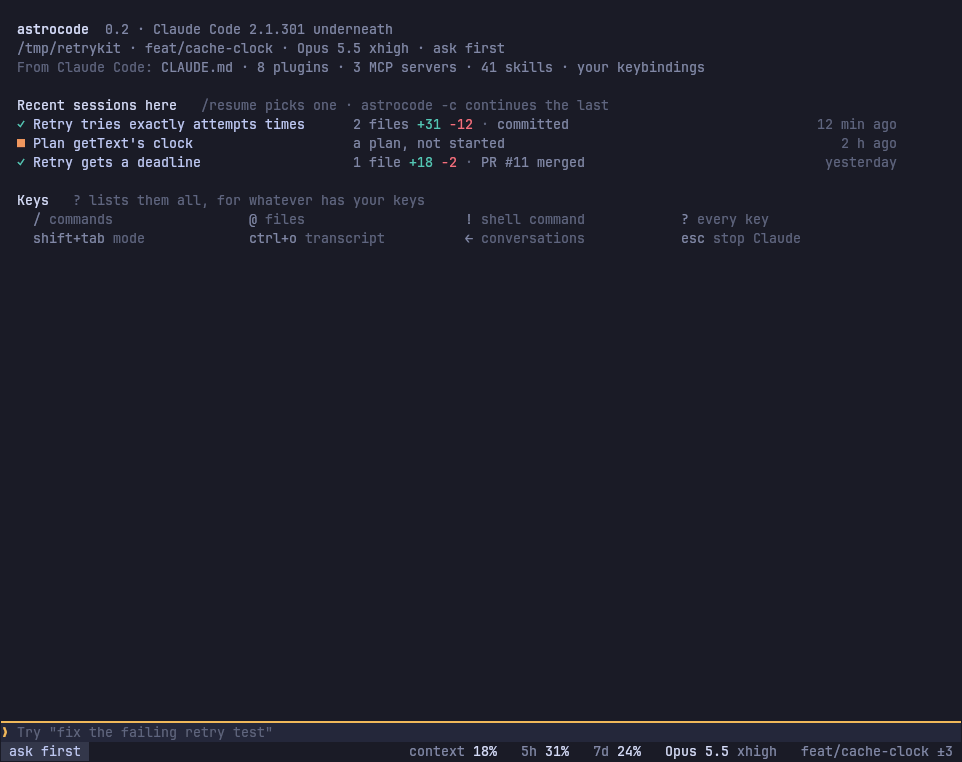

---

## Interaction model

### One focus

Your keys are always in exactly one of four places, and that place has the gold mark.

| Focus | Gold mark | How you get there | How you leave |
| :-- | :-- | :-- | :-- |
| **Box** (default) | Hairline over the box | Start; Esc from anywhere else; a click in the box | Ctrl+O, a click on the transcript, a decision or overlay opening |
| **Transcript** | `›` on the cursor's row | Ctrl+O; a click on a line; `/diff`. In scrollback, Ctrl+O opens the viewer | Esc, Ctrl+O, `q` |
| **Decision** | Hairline over the panel | It opens (after half a second) | Answering it |
| **Overlay** | Hairline over the overlay | Its command or key | Esc, or what it does |

An opened entry is part of the transcript's focus: the cursor moves into it with ↓, as into any lines.

### Rules that make keys predictable

1. **Enter acts on what's under the cursor:** sends in the box, opens or closes a line, chooses the option, runs the menu row.
2. **Esc backs out one level:** it closes what's open, leaves the transcript, closes the overlay or the menu. With nothing to back out of and Claude working, it stops Claude, as `claude` does. It never throws away typed text; Esc Esc does that, as in `claude`. In a permission prompt, Esc is No, as in `claude`.
3. **A click does what Enter does,** where you clicked, and moves your keys there. Hover changes only the background (hover tint) and the pointer; gold stays for focus.
4. **↑↓ move within whatever has focus.** In the box they're your history, as in `claude`. ← and → move between siblings (calls, pictures, lists). Tab moves between views (tabs, lists, fields).
5. **The same letter does the same thing everywhere it appears:** `c` copy, `e` open in `$EDITOR`, `o` open with the system viewer, `b` browser, `a` open all, `x` stop, `/` find, `n` note (in questions) or next match (in find).
6. **The wheel scrolls what's under the pointer,** never what's behind it.
7. **Nothing is mouse-only.** Every click target has a key, shown in the focused region's hint line.

### Every key

`claude` means the same key does the same thing in Claude Code 2.1.316 (its interactive-mode, keybindings and fullscreen docs). Keys you rebind in `~/.claude/keybindings.json` change here too, and every hint shows your binding.

**Anywhere**

| Key | Does | |
| :-- | :-- | :-- |
| Ctrl+C | Clear the box, stop Claude, or exit on the second press | `claude` |
| Ctrl+D | With an empty box: exit on the second press within 800 ms. With text: delete forward | `claude` |
| Ctrl+L | Redraw the screen, keeping your text | `claude` |
| Ctrl+Z | Suspend | `claude` |
| Ctrl+T | To-do list on or off | `claude` |
| Ctrl+O | Transcript: go there or back (full screen), or open the viewer (scrollback) | `claude` |
| Ctrl+B | Move what Claude waits on to the background | `claude` |
| Ctrl+X Ctrl+K | Stop everything in the background (twice) | `claude` |
| Shift+Tab | Next permission mode | `claude` |
| Alt+P | Model and effort | `claude` |
| Shift+↑ / Shift+↓ | Effort up and down | `claude` |
| Alt+T | Thinking on or off | `claude` |
| Alt+O | Fast mode | `claude` |
| Ctrl+X Tab | Give mods' band your keys | `claude` |
| `?` (empty box) | The key sheet, for whatever has your keys | `claude` |

**In the box**

| Key | Does | |
| :-- | :-- | :-- |
| Enter | Send; while Claude works, queue between calls | `claude` |
| Shift+Enter, Alt+Enter, Ctrl+J, `\` Enter | New line | `claude` |
| Ctrl+Enter, Ctrl+X Ctrl+S | Send now, with what's queued first | `claude` |
| Ctrl+X Enter | Send after this turn | `claude` |
| ↑ ↓ | Earlier messages, from `~/.claude/history.jsonl` too; ↑ with queued messages takes them back | `claude` |
| Ctrl+R | Search earlier messages | `claude` |
| Tab or → (suggestion showing) | Take the suggestion | `claude` |
| Esc Esc | With text: clear it into history. Empty: rewind | `claude` |
| Ctrl+S | Put the message aside, or bring it back | `claude` |
| Ctrl+G, Ctrl+X Ctrl+E | Write it in `$EDITOR` | `claude` |
| Ctrl+V | Attach the clipboard's image | `claude` |
| Ctrl+_ | Undo | `claude` |
| Ctrl+A/E/K/U/W/Y, Alt+B/F/D | Line editing. Words stop at punctuation | `claude` |
| `/` `@` `!` `#` first | Commands, files, shell, memory | `claude` |
| ← (empty box) | Conversations. The footer hints at it; it asks first if you just cleared the box | `claude` |
| Alt+W | Keep `ultracode` from starting a workflow this time | `claude` |

**In the transcript** (astrocode's; `claude`'s viewer keys work too: `q`, `/`, `{` `}`, `v`)

| Key | Does |
| :-- | :-- |
| ↑ ↓ | Move the cursor a line |
| PgUp PgDn | Half a screen, as `claude` |
| Home End, Ctrl+Home Ctrl+End | Top and end; End follows Claude again |
| `{` `}`, Alt+↑ Alt+↓ | Your previous or next message |
| `[` `]` | Previous or next turn ledger. In an opened ledger: its scope (turn, uncommitted, branch) |
| Enter | Open or close the line |
| ← → | In an opened call: the call before or after. In a ledger: the file before or after |
| Tab | The opened entry's next tab |
| `a` | Open all in this turn |
| `c` `e` `o` `b` | Copy · `$EDITOR` · system viewer · browser |
| `x` | Stop the running call or subagent under the cursor |
| `/`, `n` `N` | Find, next and previous match |
| Esc, Ctrl+O, `q` | Back to the box |

**Decisions, menus and overlays**: as listed under [Decisions](#decisions) and [Overlays](#overlays).

**Mouse** (full screen; Shift keeps the terminal's own selection)

| Do | And |
| :-- | :-- |
| Click a line | Cursor there, and Enter |
| Click the status bar's mode, model, `← N needs you` or `◌ N running` | Shift+Tab, Alt+P, ←, `/tasks` |
| Click an option or row | Choose it |
| Click in the box | Keys to the box, cursor at the click |
| Wheel | Scroll what's under the pointer |
| Drag | Select text and copy it on release: content only, not marks or padding |
| Double, triple click | Copy a word or path, or a line |
| Ctrl+click a link | Open it, as `claude` |

### Kept on purpose

| Difference from `claude` | Why |
| :-- | :-- |
| Ctrl+O in full screen moves your keys to the transcript, instead of opening a separate viewer | The transcript already is the viewer, with a cursor; Ctrl+O still toggles, and `q`, `/`, `{` and `}` still work |
| Enter on a line opens it in place, instead of expanding it | The same gesture, with tabs added |
| `[` and `]` move between ledgers | `claude` uses them for scrollback in its viewer; in full screen there's no separate scrollback |
| Alt+L (Follow Claude) retires | Replaced by opening the running line |

### How you find things

- **`?`** on an empty box shows the sheet for whatever has your keys, and so does `/help`. Every hint uses your bindings.
- **The hint line** of the focused region always shows its four to six main keys.
- **The start screen** shows eight keys and recent sessions.
- **First uses:**
  - the ledger line shows `enter or /diff to review` until you open a ledger once;
  - the box's placeholder mentions ← while another conversation exists and you've never opened the view;
  - the now line shows `ctrl+b background` when something can move.
- **The `/` menu** lists every command, astrocode's included, with what it does.

---

## Storyboards

### 1. First launch

`astrocode` in a project:
- The start screen says where you are and what came from Claude Code, lists recent sessions here, and shows eight keys.
- The box has your keys, with a placeholder. Nothing animates.

### 2. A normal turn

You send a task.
1. Your message appears with a gold `❯`; the now line reads `◐ Thinking`.
2. Claude's thinking summary lands as a `∴` line.
3. Its first sentence becomes a step heading, and calls land under it in the present tense, turning past as they finish.
4. The reply streams under the steps (`◐ Writing`).
5. At the end, the steps fold to their sentences and the ledger closes the turn. The suggestion `merge it` waits in the box.

| Working | Writing the reply |
| :-- | :-- |
|  | 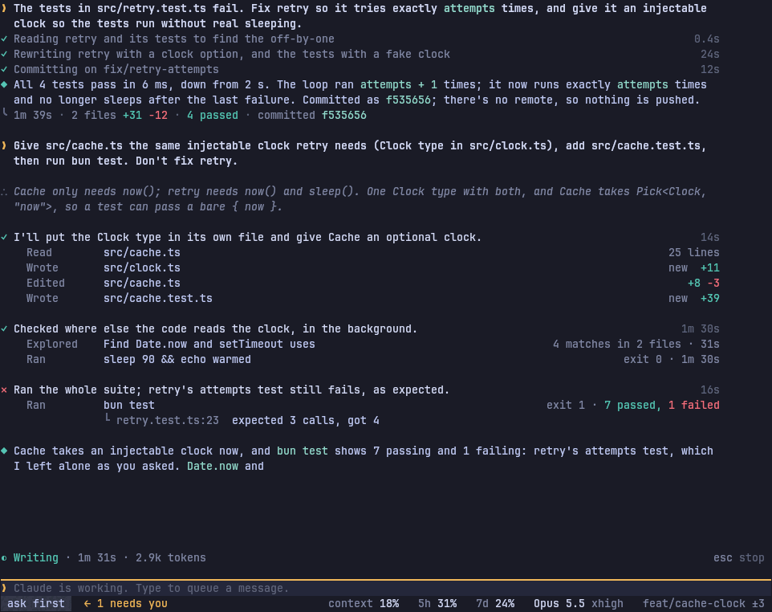 |

### 3. A permission prompt

Claude asks to edit `src/cache.ts`:
- The step's mark turns to `◇`, and the call shows as `Edit src/cache.ts  +6 −1` in gold.
- The decision opens right under it, in the box's place, with the diff and `claude`'s choices.
- The now line goes away; `waiting 18s` in the panel says it once.
- You press 1, the panel closes, and the box returns with your keys.

At 80×24 a command's prompt fits in 10 rows, with the asking line kept above it.

| 120×40 | 80×24 |
| :-- | :-- |
|  |  |

### 4. Claude asks a question

- The step reads `◇ retry's deadline check is off by one too; asking before I touch it`, and the call reads `Ask  1 question`.
- The question is the panel's title. Options carry their descriptions, and the chosen one's preview stands beside them.
- `2` answers; `n` adds a note first.

### 5. A failing-test loop

Claude runs the suite and it fails:
- The step gets `✕`. The line reads `Ran bun test  exit 1 · 3 passed, 1 failed`, and under it the assertion: `retry.test.ts:23  expected 3 calls, got 4`.
- Claude edits; the next step is `✓`. It runs again, fails differently, and the new assertion shows.
- The third run is live on the now line.

The whole loop reads top to bottom as cause, fix, evidence. When the turn ends, it folds to its sentences, with the last failure still under its `✕`.

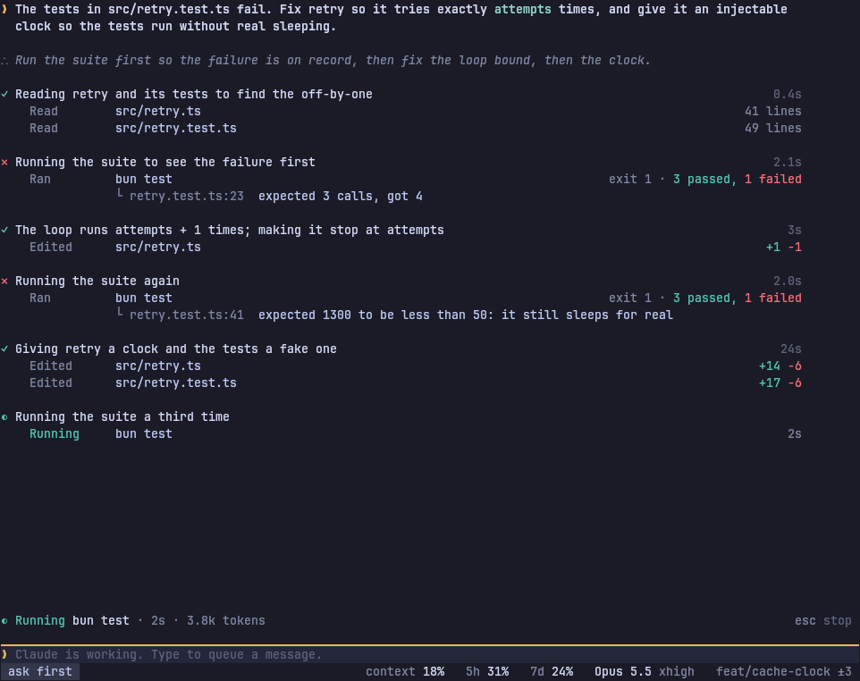

### 6. A long-running subagent

Claude starts an Explore subagent and waits on it:
- The now line reads `◐ Waiting on Explore · 1m 12s`. The subagent's line counts its calls, with its latest call under it.
- Enter on that line opens its calls under it, streaming in live, at any width.
- Ctrl+B sends it to the background; the step's mark becomes `◌` and Claude carries on.
- When it ends, a `○` notice says so, and its Report tab holds what it wrote.

### 7. Reviewing what changed

The turn ends: `╰ 1m 40s · 3 files +58 −3 · 7 passed 1 failed · not committed`.
1. `/diff`, Ctrl+O then ↑, or a click puts the cursor on the ledger, and Enter opens it.
2. ↑↓ move through files; Enter opens a file's diff for this turn, with line numbers. `]` switches to everything uncommitted.
3. `e` opens a file in your editor.
4. Esc gives the box back, where `merge it` is suggested.

### 8. Resuming a session

`/resume` (or `astrocode -r`) lists sessions from both apps, each with its ledger summary. Type to filter, then Enter:
- The transcript shows earlier turns folded: your message, Claude's sentences, the reply and the ledger.
- A `○ Resumed` notice marks where today starts.
- Ctrl+O goes back through the earlier turns.

### 9. Several conversations at once

1. ← on an empty box opens Conversations.
2. Type a task and press Enter: it starts beside the others and you stay in the view. Start another the same way.
3. Enter opens one. Inside it, `← 1 needs you` appears in the status bar when another waits on you; click it or press ←.
4. Esc goes back to the one you came from.

---

## Migration

Small PRs, shipped in this order. Each is usable on its own, and each has the tests that protect it. Steps 1 to 4 fix what the audit ranked highest before any look changes.

| # | PR | Changes | Tests that protect it |
| --: | :-- | :-- | :-- |
| 1 | `fix: say what a call is doing in the right tense` | Present tense while running; requests while waiting; `Not run` for denied; `Stopped … after Ns`; new files `Wrote … new` | `src/view/tense.test.ts`, `activity` tests: one case per tool and state, from recorded events |
| 2 | `fix: show only results a call really returned` | Test counts only from a runner's summary; the failure line from the error, not a source line; no line counts on commands | `activity` tests with real outputs: `git log` with "passed" in it, bun, pytest and cargo failures |
| 3 | `fix: keep Claude Code's meaning for Ctrl+L, Ctrl+D, Esc Esc and Shift+↑↓` | Ctrl+L redraws, Ctrl+D needs two presses, Esc Esc clears into history, Shift+↑↓ step effort | `keys` and `prompt` tests per key; a check against Claude Code's default binding table |
| 4 | `feat: share prompt history with claude` | Read and append `~/.claude/history.jsonl` for ↑ and Ctrl+R | `history` test with a temporary HOME |
| 5 | `feat: close each turn with a ledger of what changed` | Snapshot git at turn edges, so edits through Bash count; the closing line reads time · files ± · tests · commit; `~/.claude` excluded | `state` tests from replayed sessions, including the audit's Python-heredoc edit; a git fixture test |
| 6 | `feat: review a turn's changes with /diff` | The ledger opens: files with diffs, commands, commits; `[` and `]` change scope | Render tests at 80, 120 and 200 columns; key tests |
| 7 | `feat: move through the transcript with a cursor` | Ctrl+O focus, ↑↓, Enter opens in place, a click equals Enter. The Ctrl+O picker retires | Focus-model tests: exactly one focused region in every state; open-and-close round trips |
| 8 | `feat: put decisions where the box is, and say waiting once` | The decision replaces the box; the line asking stays above; `claude`'s options and Tab comments; the command printed once | Decision tests per tool; a test that "waiting" appears once in a rendered screen |
| 9 | `feat: add a ? key sheet` | `?` and `/help` show the sheet from the live keymap | Render test, with a rebinding fixture |
| 10 | `feat: drop the rail, chips and marks that said nothing` | The rail line and its rows, the transcript's start mark, inline-code chips, `›`, the diff meter, step names made from calls, one box edge, the falling-dot row, the plan name, the `shift+tab` hint | Row-budget test: a recorded turn at 120×40 fits in N rows; a palette test that gold is used only by the allowed components |
| 11 | `feat: fold finished turns and show thinking` | Steps fold to sentences when a turn ends; `∴` summaries | `state` tests; render snapshots |
| 12 | `feat: one moving mark and a now line that names the call` | `◐◓◑◒` in step with the gutter; no shimmer; retry and compact states | Animation test: idle and waiting frames are identical over time |
| 13 | `feat: lay out by width` | 110-column measure; results under their line below 100; status readings by rank | Render snapshots at 80×24, 120×40, 200×50 |
| 14 | `feat: show other conversations that need you` | `← N needs you`; the ← hint; Conversations in Ledger marks | `fleet` and agents-view tests |
| 15 | `feat: Claude Code's next-prompt suggestions` | Tab or → takes one; needs the SDK to emit them (see open questions) | `prompt` tests with a stubbed suggestion |
| 16 | `feat: a start screen that says what's next` | The mirror retires; recent sessions, loaded settings, keys | Render test |
| 17 | `feat: the transcript viewer in scrollback` | Ctrl+O opens a full-screen viewer with the same cursor | Window tests: switching in and out keeps scrollback intact |
| 18 | `feat: open the running call instead of following it in a panel` | Alt+L and the panel go; opening the running line replaces them, and follows each new call under its own line | Keybinding test: `chat:followClaude` reports as retired; open-running-line test |

Every PR keeps `bun test` and `bun run typecheck` passing, is checked in the running app with tmux and the terminal-screenshot skill at 80, 120 and 200 columns, and updates the README's matching section.

---

## Open questions

These need checking before their PRs; none blocks the earlier ones.

1. **Prompt suggestions through the SDK.** `claude -p` emits `prompt_suggestion` messages with `--prompt-suggestions` (Claude Code docs, interactive mode). Whether the Agent SDK's streaming mode exposes the same option needs a spike before PR 15.
2. **`claude`'s plan-approval choices.** I couldn't confirm their current wording in 2.1.316's binary. PR 8 should read them from the running `claude` and copy them.
3. **Per-turn git snapshots** (PR 5) need care with untracked files and large repos. A spike should measure the cost on a big repo before it ships.
