# astrocode UX audit

Phase 1 of the redesign: what astrocode draws today, what it costs, and where it fails. No design yet.

- [inventory.md](inventory.md): every element drawn, the question it answers, its cost and a verdict.
- [interactions.md](interactions.md): every key, click, hover and wheel target, per surface, with the inconsistencies.
- [sessions.md](sessions.md): what you do most in a session, from your history, and the keys each takes.
- [shots/](shots/): the screenshots below, and one contact sheet per width with every state captured.

## How it was done

- **Side by side.** astrocode (full screen) and `claude` 2.1.316, each 120×40 in one tmux window, ran the same two tasks in the same scratch repo, in ask-first mode: fix a failing retry test with an injectable clock, then add a jitter option after a question. Both on Sonnet 5.5.
- **Every width.** Separate astrocode runs at 80×24, 120×40 (full screen and scrollback) and 200×50 ran a five-part task: a background command, a background subagent, edits, a failing test run, a deny, a plan, a question and two conversations at once.
- **Replays.** Three of your long astrocode sessions (`78a7fa56`, `47ca7ea8`, `cb7a10f9`: subagents, failures, 30 pictures) replayed with `-r` at all three widths, for overlays, pictures and long transcripts.
- **Screenshots.** Captured in kitty (JetBrains Mono, Tokyo Night, as your kitty is set up) at exact grid sizes. Contact sheets: [80](shots/sheet-80.png), [120](shots/sheet-120.png), [200](shots/sheet-200.png), [side by side](shots/sheet-side.png).
- **Code.** The interaction map was read from `tui/` at `39b480b`. The claims below that differ from Claude Code were checked against the running `claude` or its docs.

Not captured live: an MCP form (no server here asks for one), a mod's band and cards (no installed mod draws one), an API error with retries, and a compaction. They're in the inventory from the code.

## Top problems, ranked

Ranked by how often you hit them in a real session (see [sessions.md](sessions.md)) and how much they cost when you do.

### 1. You can't see what a turn changed, and that's what you check before "merge"

37% of your sessions end on "merge", and 46% ask for one. The answer to "what did this turn change?" today:

- The turn's closing line says `3 files changed · 2 commands`. The list behind it opens only with a mouse click, in full screen, and has no key. It lists file names with no `+/−`, and nothing in it opens a diff.
- A diff is one tool call at a time: Ctrl+O, find the edit among every call of the session, Enter. Three edits to one file are three entries.
- Edits Claude makes through Bash don't count. In the first side-by-side task Claude rewrote both files with a Python heredoc: the closing line said `4 commands` and no files.
- A plan file written to `~/.claude/plans` counts as `1 file changed`. The count said `2 commands` where three ran.
- `/diff`, which `claude` 2.1.316 has (uncommitted changes and per-turn diffs, as a panel), answers "isn't available in this environment".

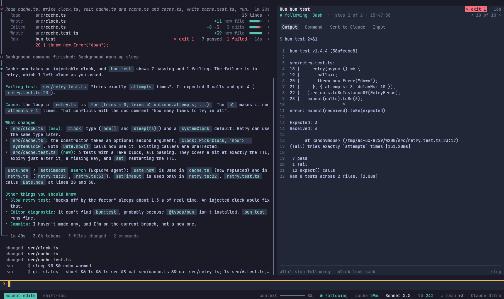
*200×50. Clicking `3 files changed · 2 commands` lists three names, with no sizes and no way into a diff. `bun test` ran but isn't listed.*

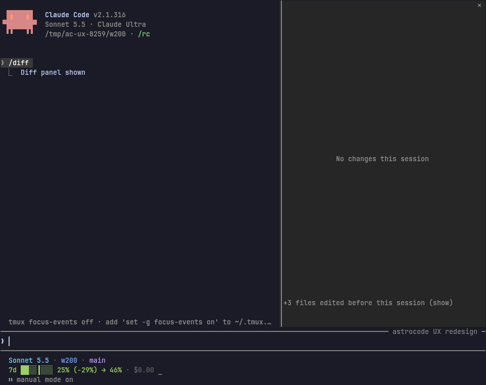
*`claude` in the same repo: `/diff` opens a diff panel beside the transcript, with the files changed before the session behind `(show)`.*

### 2. Keys a Claude Code user knows do something else

The brief's first constraint is drop-in. These break it, and three of them lose work or exit:

| Key | `claude` | astrocode |
| :-- | :-- | :-- |
| Ctrl+L | Redraws, keeps the draft (checked live) | Clears the draft |
| Ctrl+D | First press warns, second within 800 ms exits | Exits on the first press |
| Ctrl+O | Transcript viewer: everything, with search | A picker of tool calls |
| `?` on an empty box | Shortcut sheet | Types `?` |
| Esc Esc with text | Clears the draft into history | Nothing |
| Shift+↑ / Shift+↓ | Effort up / down | History |
| ↑ in a new session | Your earlier prompts, from `~/.claude/history.jsonl` | Only this run's |
| `/diff` | Diff panel | Not available |
| Next-prompt suggestion | Tab or → then Enter (you took one in 24% of sessions) | None |
| Permission prompt | "don't ask again for `python3`, `bun test`, `git add`…", "switch to auto mode", Tab adds a comment | One narrow rule or none, no comment |
| Claude's question | `n` adds notes, "Chat about this" | Neither |

Hints also hard-code keys: `shift+tab`, "Press Ctrl+C again", the `/help` text and "(Alt+P)" in menus ignore `keybindings.json`.

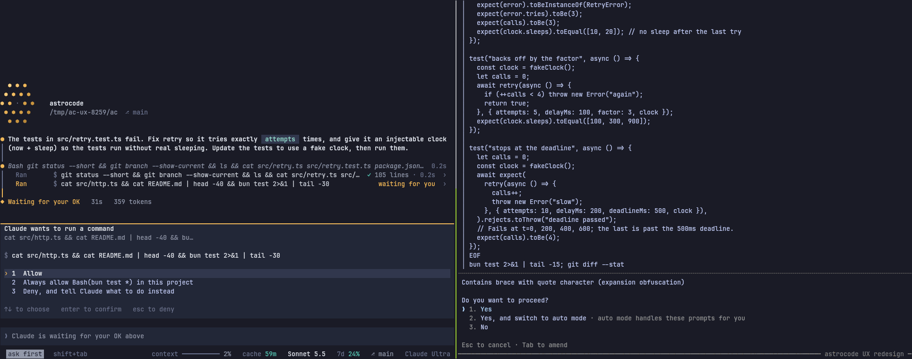
*Left astrocode, right `claude`, same moment of the same task.*

### 3. Lines that say the wrong thing

Steps and activity lines are astrocode's best idea (see "Where astrocode is better"), so wrong words there cost trust:

- **Past tense before it happens.** `Wrote src/clock.ts  waiting for you`, `Edited src/cache.ts  running`, `Ran bun test  running`, while nothing has been written or run yet.
- **Denied reads as done.** `Ran  $ bun test …  denied`.
- **Invented results.** A `git log` line reported `47 passed, 1 failed` ([replay](shots/false-test-count-120.png)).
- **The failure line points at the wrong thing.** Under a failed `bun test` it showed `20 | throw new Error("down")`, a line of the test's source, not `Expected: 3, Received: 4`.
- **Names made from calls read as noise.** `Read retry.ts, edit retry.ts and retry.ts and retry.ts and retry.test.ts, Bash bun test 2>&1 | tail -10` ([side by side](shots/edit-permission-side-by-side-120.png)), and `Bash git status --short && git branch --show-current && ls && cat …`.
- **Raw Markdown in summaries.** The agents view's summary for a finished table reply: `Done · | File | Lines |`.

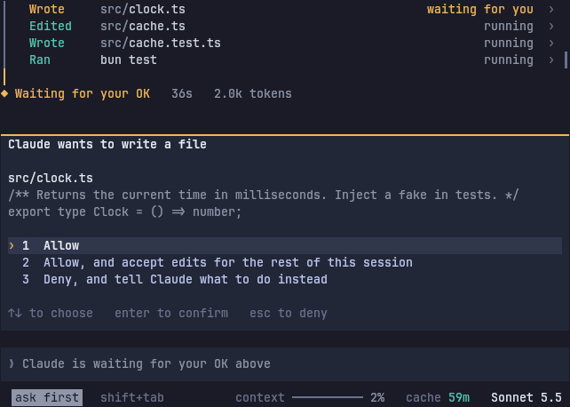
*80×24, waiting on the first write: three lines in the past tense for things that haven't happened.*

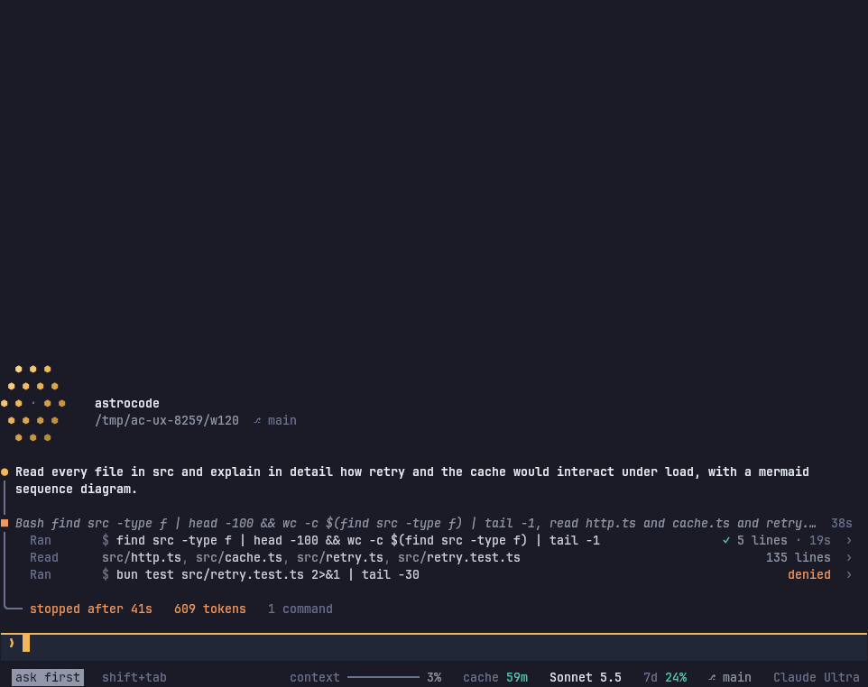
*After "Deny": `Ran … denied`, and the turn closes as stopped.*

### 4. One state said four times, while the prompt pushes the work off screen

Waiting for your OK is said by the step's gold mark, `waiting for you` on the line, `◆ Waiting for your OK  1m 7s` under it, the card's title, and `Claude is waiting for your OK above` in a message box that can't take input. At 80×24 the card leaves six rows of transcript, and a question with a preview leaves none ([80](shots/question-80.png)). A five-point plan takes 25 of 40 rows at 120×40 ([plan](shots/plan-120.png)).

- The permission card prints a command twice: cut short as its description, then whole.
- With Follow Claude on at 200 columns, the same diff shows in the Follow panel and in the card under it.
- An answered question prints the question twice: on the row, then again before the answer.
- A `!` command's output shows in its card and again in `/tasks` ([200](shots/tasks-and-card-200.png)): three panels on screen, two of them the same output.

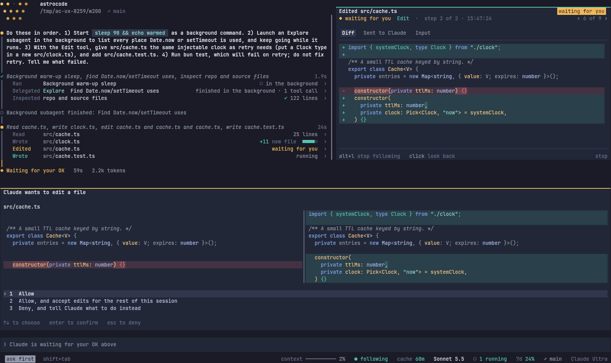
*200×50: the card's side-by-side diff and the Follow panel's diff are the same edit.*

### 5. The screen isn't used where it matters

- **Full screen pins the conversation to the bottom.** Early in a session 24 of 40 rows are blank, at every width ([200×50](shots/working-empty-top-200.png)).
- **Wide terminals stretch everything.** At 200 columns prose runs 190 characters a line and an activity line's result sits 150 columns from what it acted on.
- **Narrow terminals lose things.** At 80 the status bar drops plan usage and the account, `/config`'s descriptions are cut off, and its "Agent progress" row is a column off ([80](shots/config-80.png)). The scroll pill sits on top of the last line of text.
- **The mark costs rows.** The start screen spends 20 rows on the mirror ([120](shots/start-120.png)). Every transcript starts with a 5-row copy, saying the folder and branch the status bar already shows.

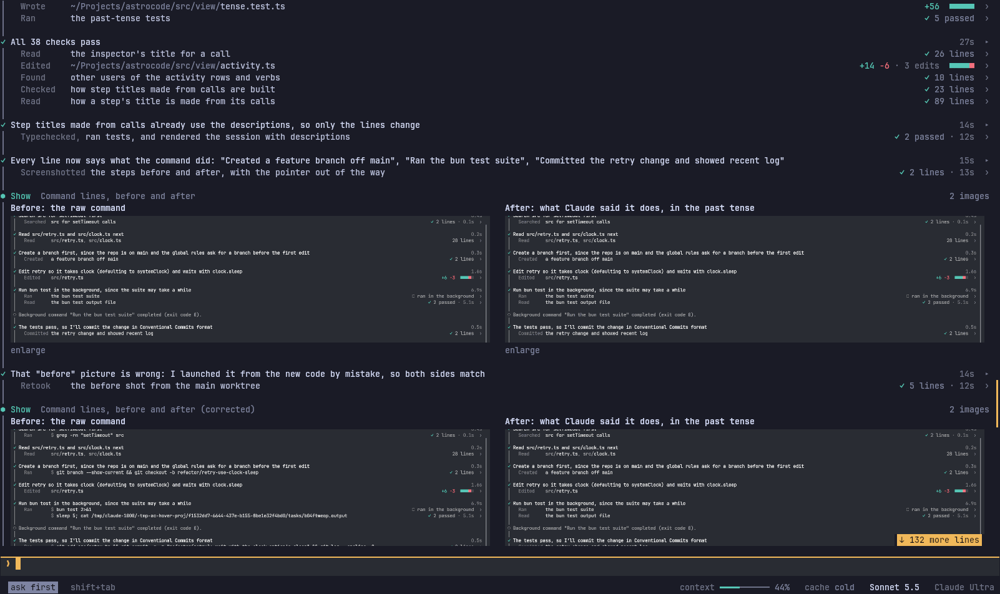
*200×50: results flush right, 150 columns from their targets; prose runs the full width.*

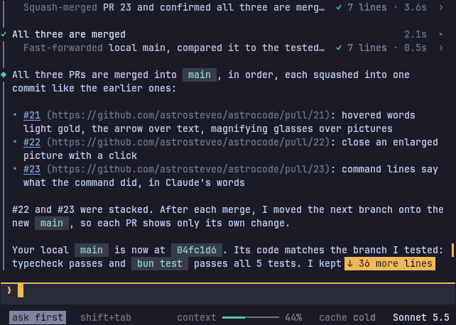
*80×24: `↓ 36 more lines` covers the end of a sentence.*

### 6. Gestures change meaning, and some things need the mouse

- **Esc** cancels, denies, saves (`/config`) or quits (the agents view, with nothing to go back to). While Follow Claude is paused by the wheel, Esc stops Claude, though the README says it resumes following.
- **A click** on a step line opens the inspector, on a step's name expands it, on a `!` card expands it, on a Bash card opens the inspector. The `▸` mark looks the same on both cards.
- **The wheel** over `/config`, prompts, questions, forms and the Follow dock scrolls the transcript behind them.
- **Mouse only.** Opening a step (the only way to see Claude's thinking), the turn's change list, copying one code block, and mods' buttons in the band. Buttons inside mods' cards do nothing at all.
- **Hard to see.** Every activity line ends with `›`, about 20 on a screen, while the closing line, `… N more` and the Follow dock are clickable with no mark at all.

### 7. Color and ornament don't carry one meaning

The README says gold is you and teal is Claude. On screen:

- **Gold** is also the `auto` mode chip, the scroll pill and "waiting".
- **Teal** is also success, `accept edits`, the cache timer, the running count, bold labels in replies and every inline code chip.
- **Inline code chips** fill and pad every identifier. The first side-by-side reply had 26 chips in 18 lines. At 80 columns they break across lines ([80](shots/chips-80.png)). `claude` colors the text only.
- **Doubled marks.** The 5-cell diff meter `■■■■□` repeats the `+9 −4` beside it. A row holding only a braille dot sits above the live line.

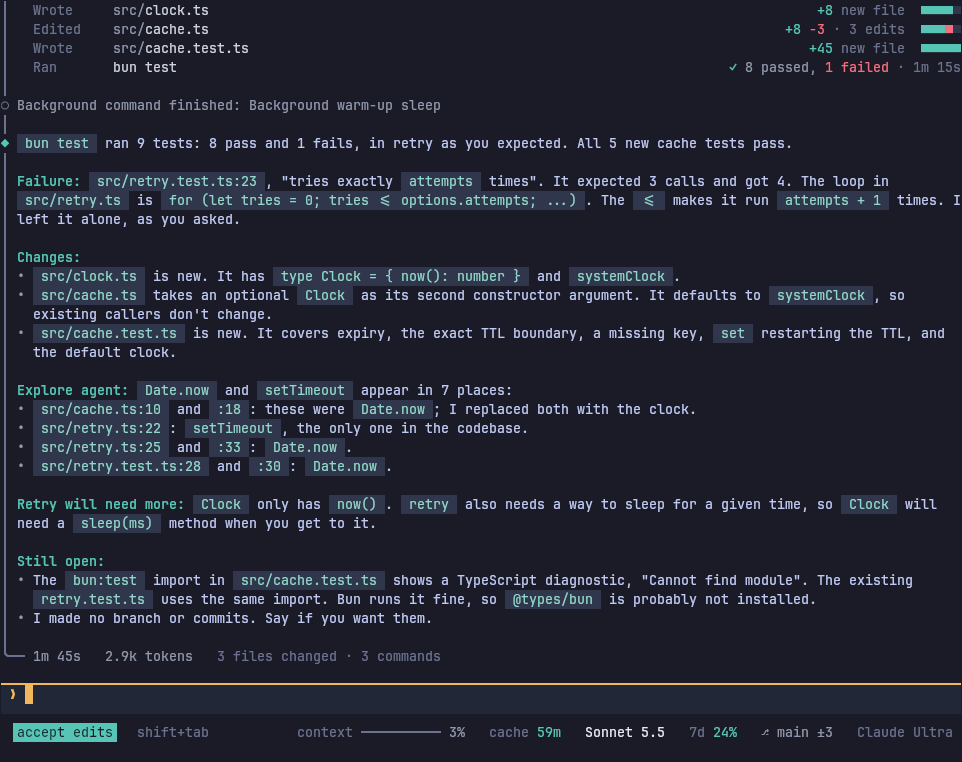
*120×40, scrollback: a reply where most lines carry two or more filled chips.*

### 8. Claude's thinking is hidden

`claude` shows Claude's thinking above the call it led to, through your `inline-thinking` mod. In astrocode it shows only inside an opened step, and a step opens only with a click.

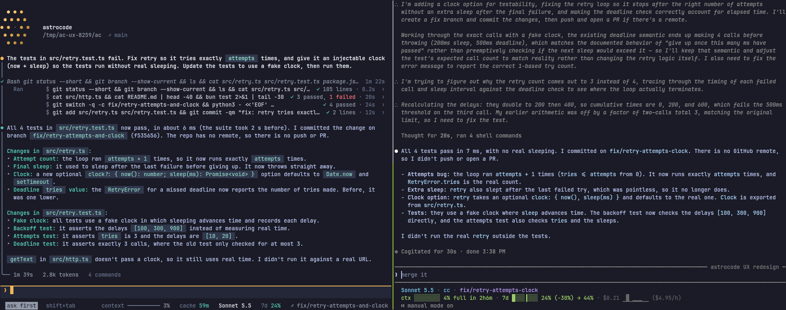
*The same finished turn. Right: thinking above the result. Left: none, and the step's name is the first command.*

### 9. Running several conversations, you can't see the others

The agents view lists them well and starting several works as `claude agents` does. Inside a conversation, though, nothing says another one is working or waiting on you. You find out by pressing ← on an empty box, which opens the view at once, with no hint that it exists. `claude` shows `← for agents` in its footer.

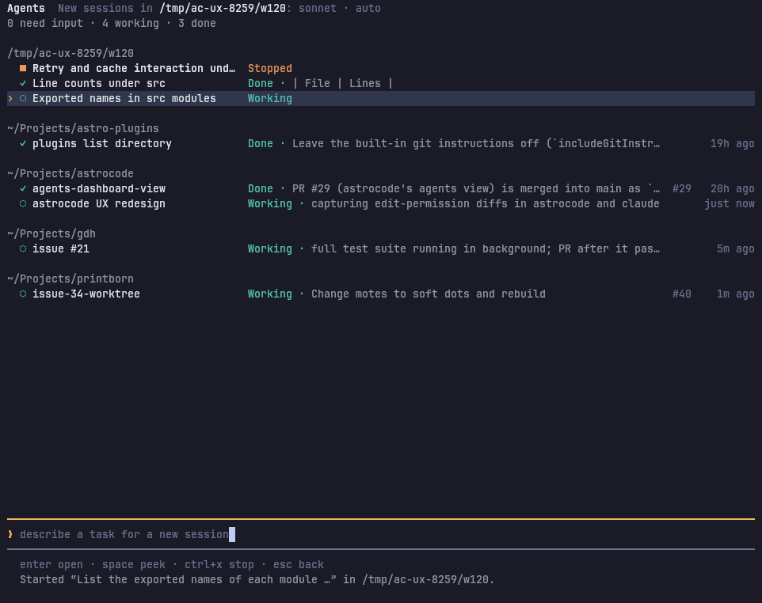
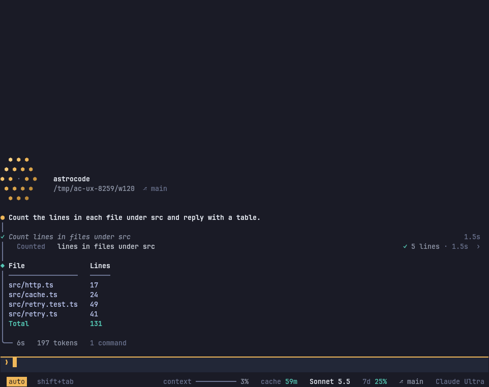
*Two conversations started from the view. Opened, one of them shows nothing about the other.*

### 10. Features are found in the README or not at all

`/help` is 35 lines of prose that scrolls past its own start. There is no shortcut sheet. Ctrl+F, Alt+↑↓ and clicking a closing line are only in `/help`. Keybindings support, the inspector's Space/PgUp/Home keys and the Follow dock's clicks are only in the README. Ctrl+D's one-press exit and `q` in the lightbox are nowhere.

| astrocode `/help` | `claude` `?` |
| :-- | :-- |
| 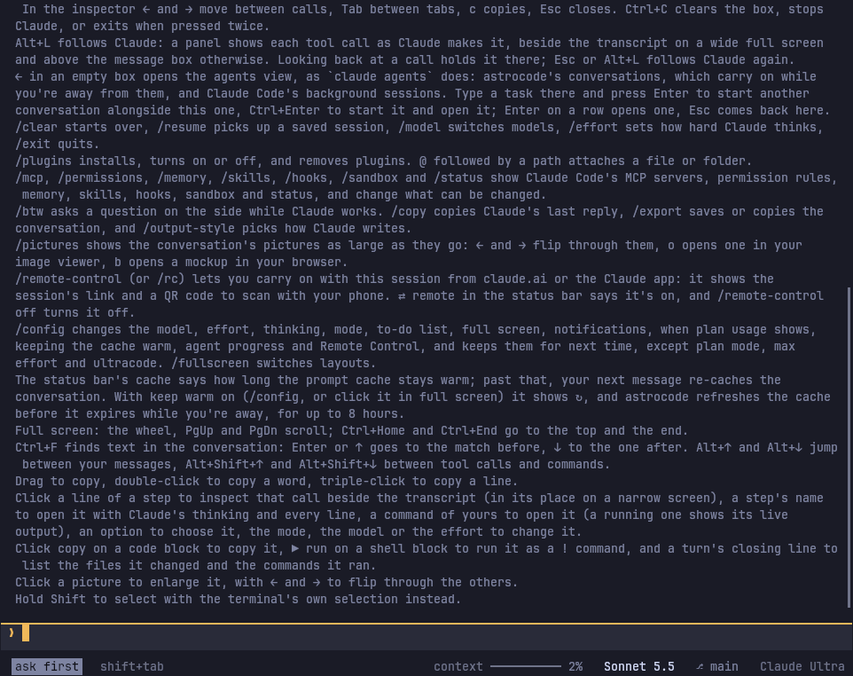 | 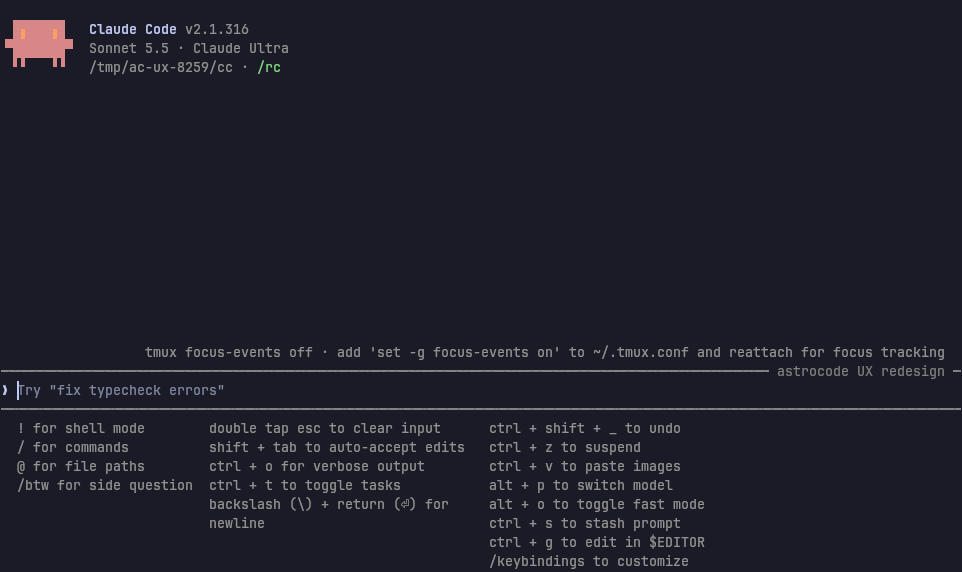 |

## Measurements at 120×40

### Rows of content against chrome

Counted per row from the text captures in [captures/](captures/) with `python3 captures/rows.py captures/*.txt`. "Content" is your prompt, Claude's words, activity lines, prompts' bodies and output; everything else (blank rows, rail-only rows, panel edges, the box, the status bar, the start mark, step names made from calls, closing lines, hint lines) is chrome.

| Moment | astrocode | claude |
| :-- | --: | --: |
| Claude working, first turn | 3 of 40. Blank 24, start mark 6, fixed chrome 7 | 35 of 40 (showing a long command) |
| Permission prompt, first turn | 10 of 40. Blank 14, start mark 5 | 35 of 40 |
| First turn done | 21 of 40 (52%) | 24 of 40 (60%) |
| Second turn done | 25 of 40 (62%) | 27 of 40 (67%) |

- **Fixed chrome:** 4 rows idle (box with two soft-edge rows, status bar) and 6 while working (a live line and a row holding a single braille dot). `claude`: 3 rows of box, plus your 3-row status line.
- **Per turn:** about 7 rows that carry only the rail, 1 row per step for its name, and the closing line. `claude` spends about the same on blank rows.

The per-turn cost is close to `claude`'s. The losses are the blank top of a young full-screen session, the start mark, and prompts that repeat themselves.

### Glances

One glance is one place on screen to look at. "+ key" and "+ click" mean you have to act first.

| Question | astrocode | claude |
| :-- | :-- | :-- |
| Is Claude working or waiting on me? | 1: the live line over the box (but said up to 4 times when waiting) | 1: spinner, or the dialog |
| What is it doing now? | 2: the live line names the tool ("Running Bash"), the teal line in the step names the target. 1 with Follow Claude on | 2: the last tool row; the spinner's verb ("Proofing…") is decoration |
| What did it change this turn? | 3+ and a click: scroll to the closing line, click, read names without sizes. Diffs one call at a time through Ctrl+O. Bash edits missing | 1 + `/diff` |
| How much context and plan is left? | 1: `context ── 3%` and `7d 24%` in the status bar. At 80 columns plan usage is dropped | 0 by default (`/context`, `/usage`). 1 with a custom status line like yours |

## Where claude does better

- `/diff`, with per-turn diffs.
- Ctrl+O's transcript viewer: the whole session, searchable.
- `?` shortcut sheet.
- Next-prompt suggestions.
- Permission prompts that offer rules for every command in a compound command, a switch to auto mode, and a comment on any answer.
- Notes on an answer to Claude's question.
- Line numbers in diffs.
- A finished turn's calls fold to one line ("Thought for 20s, ran 4 shell commands").
- Ctrl+L, Ctrl+D and Esc Esc never throw away a draft or exit by surprise.
- ↑ recalls prompts from earlier sessions.

## Where astrocode is better, and must not regress

- **Steps and activity lines.** A long session reads as a log of what Claude did, in Claude's words, past tense, one line per action ([replay](shots/steps-long-session-120.png)). This is the strongest thing astrocode has.
- **The inspector.** Everything about one call, in tabs, ← and → through the calls. At 140 columns and up it sits beside the transcript and keeps the call's line marked ([200](shots/inspector-beside-200.png)).
- **Diffs before you approve.** They're tinted, not flooded with green, and side by side at wide widths.
- **Claude's questions with previews.** Rendered previews beside each option; digits pick ([side by side](shots/question-side-by-side-120.png)).
- **Pictures and diagrams in the transcript** (kitty), and `/pictures`.
- **The status bar.** Context, plan usage and cache built in, where `claude` needs a custom status line.
- **The agents view with astrocode's own conversations in it.**
- **The half-second guard on permission prompts.** Stash, Ctrl+X Enter and the mode chip too.
- **Startup.** The box is ready in under 1.5 s.
