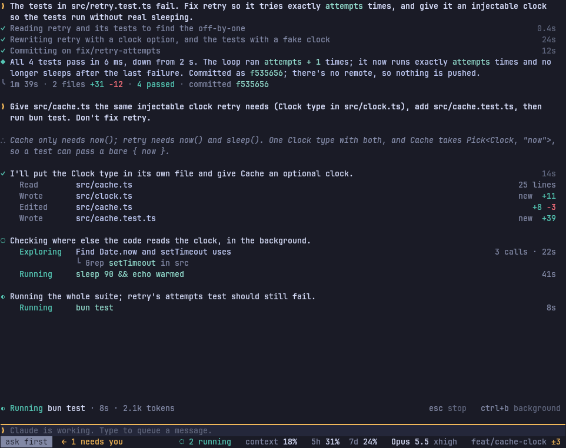
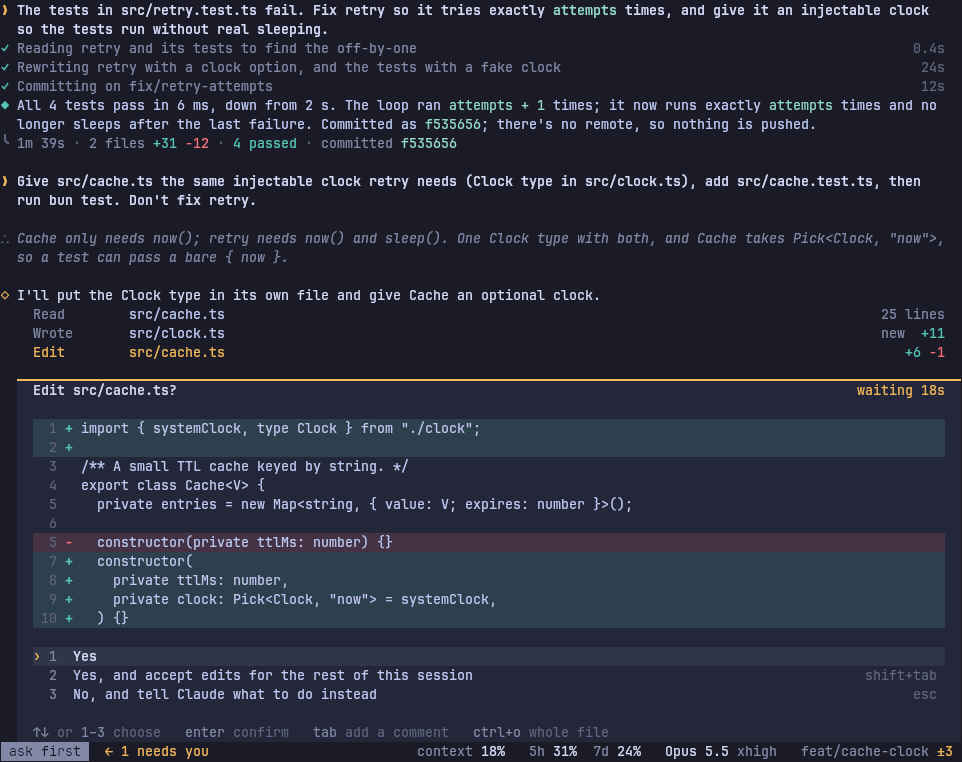
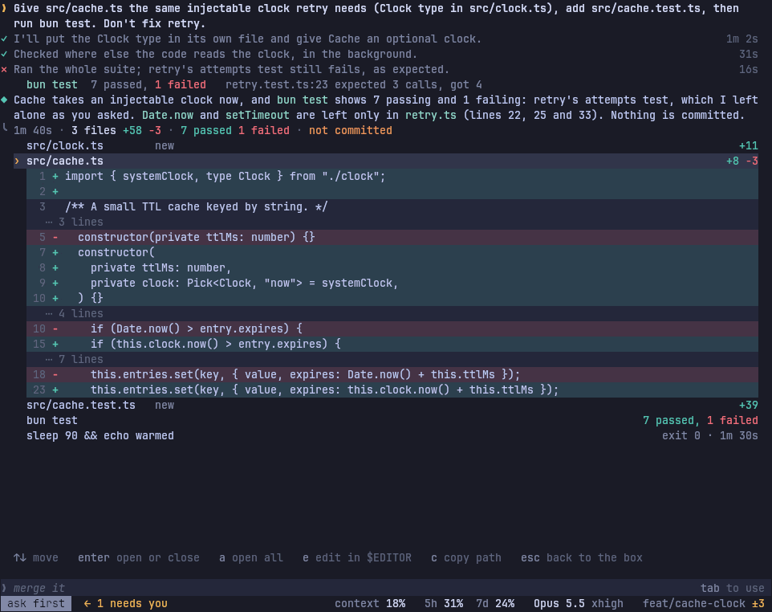
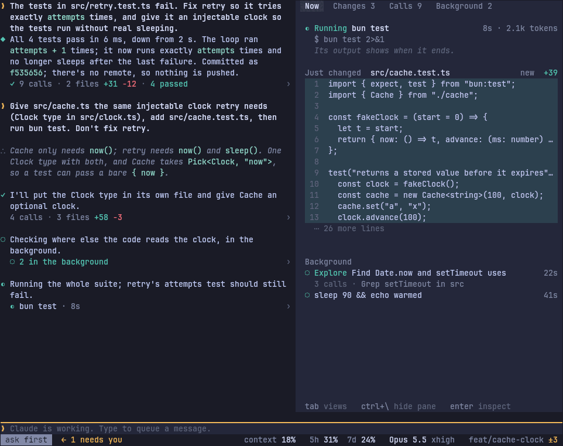
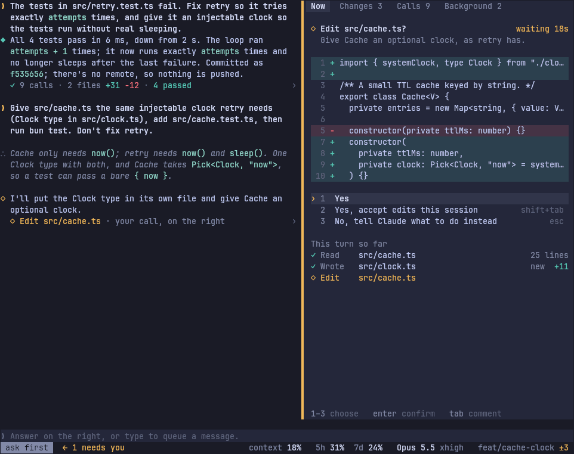
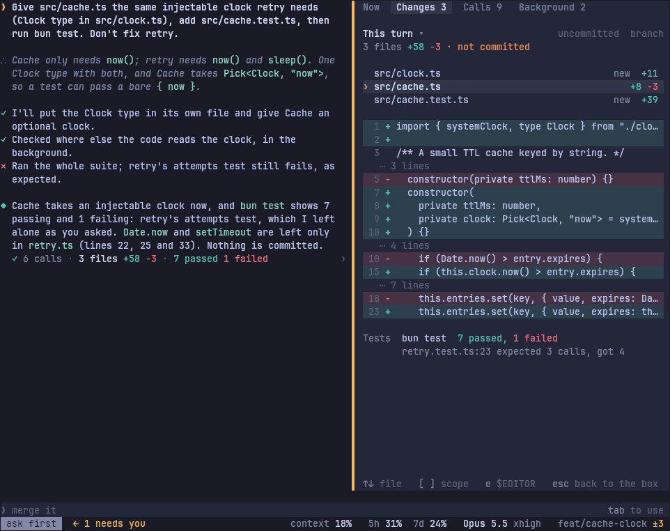
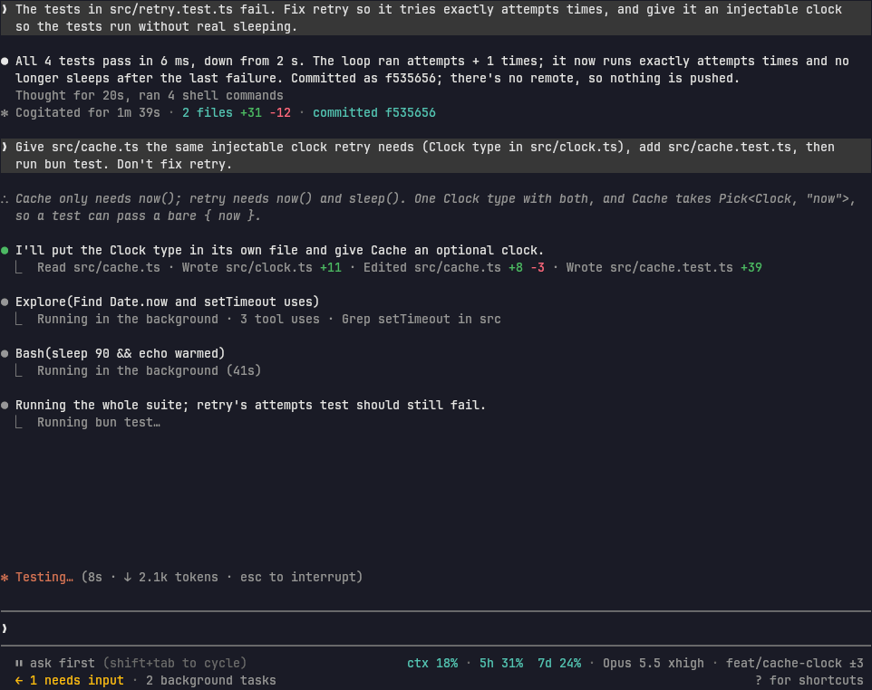
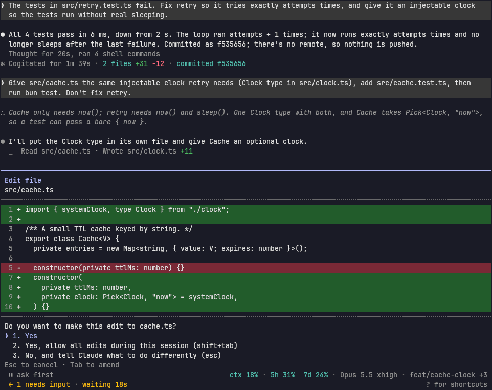
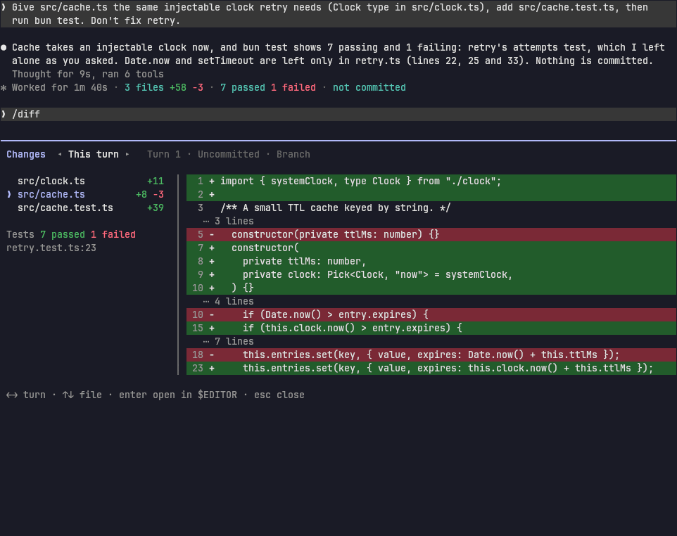

# Three directions

Phase 2 of the redesign. Each direction answers the [audit](../audit/README.md) differently. All three draw the same session at 120×40: turn 1 fixed retry's off-by-one; turn 2 gives the cache the same clock, with a background subagent and command, then a test run that's expected to fail.

The three moments:

1. **Working.** Claude mid-turn, running the tests.
2. **Permission.** Claude asks to edit `src/cache.ts`, in ask-first mode.
3. **Review.** The turn has finished, and you check what it changed before saying "merge".

Every mockup is a grid of cells printed as true-color ANSI by [`../mockups/`](../mockups/) and screenshotted in kitty. `docs/design/mockups/shoot.sh` redraws them all.

Before shooting, `check.ts` confirms each frame is exactly 120×40 and that every glyph is in DejaVu Sans Mono. Direction C's `⎿` and `⏸` are exempt: `claude` draws those itself.

---

## A. Ledger

**One column that reads as the record of what Claude did and changed. A cursor opens any line in place, and each turn closes with a ledger of its changes, which is also the review.**

**Optimizes for**
- **Drop-in.** One stream, as in `claude`. Claude Code's keys keep their meanings: Ctrl+O opens the transcript (with a cursor added), and `/diff` opens the turn's changes. Claude Code's next-prompt suggestion appears in the box.
- **Lines that are true.**
  - A line is in the present tense while it runs (`Running bun test`) and in the past tense once done (`Edited`).
  - A call waiting on you reads as a request (`Edit src/cache.ts`, in gold).
  - Nothing claims to have happened before it has.
- **One place per question.**
  - The gutter's mark says how a step stands.
  - The line over the box says what's happening now.
  - The ledger says what changed.
  - Waiting on you is gold, and it shows only where you act.
- **Open in place.** Enter opens what's under the cursor right there: a diff, a command's output, a subagent's work, the thinking. It works the same in scrollback and in full screen.

**Cuts**
- The rail's line and the rows that only carry it.
- The start mark in the transcript, and the 20-row mirror.
- Inline code chips: code is colored, not boxed.
- `›` on every line, and the diff meter bar.
- Step names made from calls.
- The Ctrl+O picker.
- Follow Claude's separate panel: the line over the box names the call, and opening the running line shows it live.
- The repeated "waiting" messages.
- One of the box's two edge rows.
- From the status bar: `Claude Ultra`, `shift+tab`, and the cache timer until it matters.

**Keeps**
- Steps named in Claude's words, and activity lines.
- The inspector, as an opened line.
- Gold for you and teal for Claude.
- Finished turns fold to Claude's step sentences, so a long session still reads as a log.

**Widths**
- **80.** The same column. A result that doesn't fit moves under its line. The status bar keeps the mode, who needs you, the context and the plan.
- **120.** As drawn.
- **200 and up.** Prose stops at about 110 columns. An opened diff or call uses the full width, or stands beside the column, as today's inspector does at 140 and up.

**Ink:** rows of text throughout. Full screen already keeps each transcript line tied to its call (`tui/transcript.tsx`), so a cursor can sit on any line. In scrollback, an opened line has to be drawn in the live area until it's closed.

**Risk:** a cursor in the transcript is a second place your keys can be. The spec has to make obvious which one has them.

| Working | Permission | Review |
| :-- | :-- | :-- |
|  |  |  |

---

## B. Workbench

**Split what Claude says from what Claude does: the conversation on the left; on the right a work pane that follows the live call, shows each change as it lands, holds the decisions, and becomes the review when the turn ends.**

**Optimizes for**
- **Fixed places.** Each answer has a place that never moves. Words are on the left; calls, diffs and decisions are on the right.
- **Watching edits land.** The pane shows the file Claude just wrote while the next call runs.
- **Reviewing while reading.** The changes sit beside the reply that describes them.

**Cuts**
- Activity lines in the conversation: one line per step stands for its calls, and opens them in the pane.
- The inspector and Follow Claude as separate things: they become the pane's views (Now, Changes, Calls, Background).
- The rail, the start mark and the mirror.
- Chips and the `›` on every line.

**Widths**
- **110 and up.** Two panes. The work pane is 56 columns at 120 and about 90 at 200.
- **Under 110.** The pane becomes a full-screen view you switch to, so at 80 it's a different app.

**Ink:** two independent scrolling areas side by side, each with its own focus and its own long list.
- **Full screen only.** Scrollback can't hold a pane, so B means dropping scrollback or keeping it as a lesser mode.

**Risks**
- At 120, code is cut at 56 columns.
- The session no longer reads as one log.
- It is the furthest from `claude`.

| Working | Permission | Review |
| :-- | :-- | :-- |
|  |  |  |

---

## C. Claude Code, plus

**Be `claude` on screen, with its glyphs, dialogs, colors and keys, and add only what it lacks.**

**Optimizes for**
- **Zero relearning.** The permission dialog is `claude`'s, word for word.
- **Parity first.** Every `claude` feature looks and works as it does there.
- **Low build risk.**

**Adds**
- Claude's sentence on `claude`'s grouped tool lines.
- Changes, tests and commit on each turn's done line.
- Thinking, shown.
- The other conversations and the plan usage in the footer.
- A per-turn `/diff`.
- Pictures.

The additions are drawn in teal in the mockups.

**Cuts**
- The Hubble palette, the mirror and the rail.
- Steps and activity lines as drawn today.
- Panels.
- The inspector as its own surface: `claude`'s Ctrl+O transcript viewer takes its place.
- Follow Claude.

**Widths:** as `claude`.

**Ink:** what `claude`'s own Ink renderer does, so it's the easiest of the three.

**Risks**
- astrocode stops looking or feeling like its own product.
- The aim of a more productive interface shrinks to a few additions.
- `claude` changes its look often, and C has to follow each time.

| Working | Permission | Review |
| :-- | :-- | :-- |
|  |  |  |

---

## Side by side

| | A. Ledger | B. Workbench | C. Claude Code, plus |
| :-- | :-- | :-- | :-- |
| What changed this turn (audit #1) | The ledger closing the turn, with sizes; Enter opens each file's diff in place; also `/diff` | The pane's Changes view, next to the reply | `/diff` per turn, plus the done line |
| Drop-in (#2) | `claude`'s keys keep their meanings; additions are new keys | New layout; `claude`'s keys work, but the pane is new territory | Closest |
| Lines that are true (#3) | Tense and state rules on every line | Same rules, in the pane | `claude`'s wording; steps get Claude's sentence |
| Waiting said once (#4) | Gold on the line, and the decision opens under it | Gold in the conversation, the decision in the pane | `claude`'s dialog |
| 80 columns | Same design | Different: one pane at a time | Same as `claude` |
| 200 columns | Capped text, wide diffs beside | Best use of the width | As `claude` |
| Scrollback | Yes | No | Yes |
| Keeps astrocode's strengths | Steps, inspector, palette | Inspector and Follow, as the pane | Few |
| Build size from today | Smallest: mostly cutting, rewording and a transcript cursor | Largest: a second scrolling area and a new layout | Medium: redraw everything as `claude` |

## Recommendation: A, Ledger

1. **It fixes the top three problems where you already look.** You read the end of the turn before typing "merge"; the ledger is there, with sizes and diffs one key away. Tense rules fix the wrong words. `claude`'s keys keep their meanings.
2. **One design from 80 to 250 columns, in scrollback and full screen.** B is a different app under 110 columns and only works in full screen.
3. **It keeps what astrocode does best,** a session that reads as a log in Claude's words, and keeps its own look. C gives both up.
4. **It's the smallest move from today's code.** Steps, activity lines, the inspector and the line-to-call map in full screen already exist. Most of the work is cutting, rewording and a cursor.

**What A should borrow**
- **From B:** at 160 columns and up, an opened call or diff stands beside the column, as the inspector does now. "Watching edits land" becomes something you turn on for the line over the box.
- **From C:** `claude`'s permission wording and choices, and its folding of a finished turn's calls into one line.

You picked A; the [spec](../README.md) specifies it.
